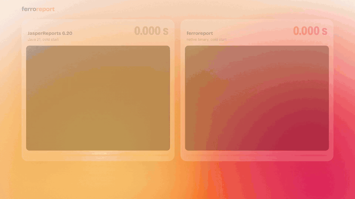

# ferroreport

**Reportes en milisegundos, desde cualquier lenguaje.** ferroreport es un motor de reportes:
le das una plantilla y tus datos y escribe el PDF, el Excel, el Word, el PowerPoint, la hoja de cálculo o el
texto OpenDocument, el CSV o una vista previa web. Una factura tarda
**3 ms**; **un millón de filas** tardan 18 segundos y usan **19 MB de memoria**, porque las
filas se leen a medida que hacen falta y cada página se escribe apenas se termina. Es un solo
binario pequeño, sin nada que instalar, y las plantillas **no pueden ejecutar código** en tu
servidor.

Lee las plantillas de JasperReports (`.jrxml`) que ya tienes y saca el mismo resultado,
**píxel por píxel**: puedes diseñar en Jaspersoft Studio y cambiar de motor sin tocar un
reporte. O escribe las plantillas en [su propio formato](#plantillas-jrxml-o-ferro), de la
mitad del tamaño de un JRXML y accesible por defecto. Frente al propio JasperReports es unas **200 veces más rápido arrancando en frío** y
**de 3 a 5 veces más rápido que una JVM ya caliente** ([los números](#rendimiento)).

<p align="center"><a href="https://cristianencarnacion.github.io/ferroreport/"></a></p>

**[Pruébalo en tu navegador](https://cristianencarnacion.github.io/ferroreport/)** ·
[Diseña un reporte](https://cristianencarnacion.github.io/ferroreport/designer/) ·
[Descargas](https://github.com/cristianEncarnacion/ferroreport/releases) ·
[Docker](https://github.com/cristianEncarnacion/ferroreport/pkgs/container/ferroreport)

> Estado: **estable desde la 1.0; la última versión es la 1.3.0** ([qué trajo cada versión](CHANGELOG.md)).
> Las 48 plantillas comparables de la batería de pruebas salen píxel por píxel igual que en JasperReports 6.20, incluyendo bandas divididas entre páginas,
> imágenes (también SVG), subreportes, tablas, listas, crosstabs, códigos QR, PDF417, Barbecue
> y de barras, enlaces, texto con formato y varias columnas; los gráficos se dibujan como los
> dibuja JasperReports 7 (21 de sus 24 muestras de gráficos salen iguales). Las 49 que ambos
> motores pueden exportar dan el mismo Excel y CSV, las
> 51 pasan las pruebas PDF/UA-1, PDF/A-2a, PDF/A-3b y PDF/A-2b (firmado) de veraPDF, y las
> muestras del propio JasperReports se comparan contra 6.20.6 y 7.1.1. `ferroreport doctor` te
> dice si todo lo de tu plantilla está soportado; lo que aún falta está en
> [compatibilidad](README.md#compatibility). Desde la 1.0 las versiones siguen
> [versionado semántico](#estabilidad). No está afiliado a Jaspersoft ni a Cloud Software Group.

## Por qué

- **Rápido y con memoria plana.** Un binario de ~8 MB (con las fuentes incluidas) que arranca
  en milisegundos; importa en CLIs, funciones serverless y contenedores. Las filas entran y
  las páginas salen sin acumularse: un reporte de un millón de filas usa la memoria de uno de
  diez.
- **Salida idéntica.** Cada fixture se renderiza con los dos motores y se compara píxel por
  píxel: hoy los 48 comparables salen idénticos. Sus exportaciones a Excel y CSV se comparan
  celda por celda, y las 49 coinciden.
- **PDF, Excel, Word, PowerPoint, OpenDocument, CSV y HTML.** La misma plantilla da un PDF
  (etiquetado para lectores de pantalla si quieres, PDF/UA-1), un `.xlsx` armado como el de
  JasperReports (celdas combinadas, fuentes, rellenos, bordes, alturas de fila, imágenes y
  gráficos), un `.docx` armado como el Word que exporta Jasper, un `.pptx` con una diapositiva
  por página, `.ods` y `.odt` para LibreOffice armados de la misma forma, un CSV o una página
  web que se ve como el PDF, para vistas previas.
  Los enlaces, anclas y marcadores funcionan en todos.
- **PDF para archivar, enviar y proteger.** PDF/A-2 y PDF/A-3 (niveles a, b y u), verificados
  con veraPDF en cada cambio; archivos dentro del PDF, como el XML de una factura electrónica;
  cifrado AES-256 con contraseña y permisos (imprimir, copiar, modificar...). Todo en el motor
  de código abierto, con las propiedades de plantilla que ya usa JasperReports o con una opción.
- **JRXML, o un formato propio.** Las plantillas de Jaspersoft Studio funcionan tal cual (JRXML
  6 y 7). Las nuevas se pueden escribir en `.ferro`, un esquema que una persona lee y escribe a
  mano, sin coordenadas si quieres: las partes se apilan y se ponen en filas, y lo que se repite
  se define una vez. `ferroreport convert` pasa de uno a otro, y de JRXML 6 a 7.
- **Migra un proyecto entero de una vez.** `ferroreport migrate reportes/` revisa cada plantilla
  de una carpeta (si carga, qué usa, qué no está soportado aún, si se renderiza), escribe el
  resultado en Markdown o JSON y, si lo pides, las plantillas convertidas. Si le das los jars
  de JasperReports (`--jasper lib/`), renderiza cada plantilla con los dos motores y los mismos
  datos, y compara páginas, cada texto y número, los píxeles de cada página (con `pdftoppm` en
  el PATH) y tiempos. La
  [guía de migración](https://cristianencarnacion.github.io/ferroreport/es/migrate.html) lleva un
  proyecto de JasperReports paso a paso: scriptlets, archivos `.jasper`, la llamada en Java,
  fuentes de datos y exportaciones.
- **Seguro con plantillas ajenas.** JasperReports compila las expresiones a Java y carga
  archivos `.jasper` serializados; así ocurrieron fallos recientes de ejecución remota de código
  (CVE-2025-10492, CVE-2026-6009). ferroreport nunca deserializa objetos e interpreta las
  expresiones con una lista cerrada de operaciones: sin reflexión, sin carga de clases, sin
  acceso a la red. Las imágenes y subreportes solo se leen de las carpetas de recursos de la
  plantilla, y hay límites de anidamiento, tamaño de imagen, subreportes, páginas, filas y tiempo
  para que una plantilla hostil no agote la memoria ni el procesador. En cada cambio, las
  plantillas de prueba se dañan de miles de formas y el motor debe responder con un documento
  o un error, nunca caerse ([SECURITY.md](SECURITY.md)).
- **Úsalo desde cualquier lenguaje.** Paquetes para JavaScript (Node.js, Deno, Bun y
  navegadores), Python y Java (Quarkus, Spring; lee un `ResultSet` fila por fila, ver
  [bindings/java](bindings/java/README.md)), librería de Rust, CLI, y una API HTTP en imagen
  Docker para todo lo demás (C#, PHP, Go, Ruby...). El servidor no escucha fuera de localhost
  sin token.

## Desde tu lenguaje

> **[Documentación completa](https://cristianencarnacion.github.io/ferroreport/es/docs.html)**: cada comando,
> endpoint, función y opción. El [paquete de npm](https://www.npmjs.com/package/ferroreport), el
> [de PyPI](https://pypi.org/project/ferroreport/), la librería de Java en Maven Central
> (`io.github.cristianencarnacion:ferroreport`), los [crates](https://crates.io/crates/ferroreport), los
> [binarios de Releases](https://github.com/cristianEncarnacion/ferroreport/releases) y la imagen Docker ya están disponibles.

- **JavaScript/TypeScript:** `npm install ferroreport` y
  `render(plantilla, filas, parametros, { locale: "es_DO" })` devuelve el PDF; con
  `{ format: "xlsx" }`, `"docx"`, `"pptx"`, `"ods"`, `"odt"` o `"csv"`, el Excel, el Word, el
  PowerPoint, el OpenDocument o el CSV.
- **Python:** `pip install ferroreport` y
  `ferroreport.render("factura.jrxml", filas, parametros, locale="es_DO")` (agrega
  `format="xlsx"`, `"docx"`, `"pptx"`, `"ods"`, `"odt"` o `"csv"`, o usa `render_to_file(..., "factura.xlsx", ...)`).
- **Cualquier lenguaje por HTTP:**
  `docker run -p 8080:8080 -v "$PWD/plantillas:/templates" -e FERROREPORT_TEMPLATES=/templates -e FERROREPORT_TOKEN=cambiame ghcr.io/cristianencarnacion/ferroreport`
  y luego `POST /render/factura` con `Authorization: Bearer cambiame` y
  `{"data": [...], "params": {...}}` te devuelve el PDF (agrega `"format": "xlsx"`, `"docx"`, `"pptx"`, `"ods"`,
  `"odt"`, `"csv"` o `"html"` para Excel, Word, PowerPoint, OpenDocument, CSV o una vista previa web). Para reportes con más filas de las que
  quieres en memoria, envíalas una por línea (`Content-Type: application/x-ndjson`: la
  petición en la primera línea y una fila en cada línea siguiente) y el servidor las lee a
  medida que el reporte las necesita: un millón de filas con el servidor en unos 50 MB. La
  respuesta es el documento completo o un error, nunca medio PDF; con
  `Prefer: respond-streaming` llega mientras se genera (primeros bytes al instante, y si el
  cliente se va, el reporte se detiene).
- **Java:** la dependencia `io.github.cristianencarnacion:ferroreport:1.3.0` de Maven Central
  (Java 11 o más nuevo, sin dependencias ni JasperReports) y
  `Ferroreport.local().template(Path.of("factura.jrxml")).rows(lineas).param("CLIENTE", "Caribe").render()`;
  con `.rows(resultSet).renderTo(Path.of("ventas.pdf"))` un query va directo al archivo sin
  cargarse en memoria.
- **Rust:** `cargo add ferroreport`. **Línea de comandos:** binarios en
  [Releases](https://github.com/cristianEncarnacion/ferroreport/releases); `-d -` y `-o -` leen
  las filas de stdin y escriben el PDF en stdout.

## Inicio rápido

```bash
cargo install --path crates/ferroreport-cli

ferroreport render factura.jrxml --data filas.json --params parametros.json -o factura.pdf --locale es_DO
ferroreport render factura.jrxml --data filas.json -o factura.xlsx   # Excel (o .docx, .pptx, .ods, .odt, .csv, .html)
ferroreport doctor factura.jrxml     # qué soporta (y qué no) esta plantilla
ferroreport migrate reportes/ --report migracion.md   # lo mismo para una carpeta entera
ferroreport migrate reportes/ --jasper jasper/lib --strict   # y comparado con JasperReports
ferroreport migrate reportes/ --jasper jasper/lib --strict --strict-pixels   # fallando también si una página se ve distinta
ferroreport convert factura.jrxml -o factura.ferro   # la misma plantilla en el formato de ferroreport
```

`filas.json` es un arreglo JSON de objetos, o un objeto JSON por línea, cuyas claves coinciden
con los `<field>` de la plantilla. El archivo se lee a medida que el reporte lo necesita y cada
página se escribe apenas se termina, así que puede ser mucho más grande que la memoria;
`--max-pages`, `--max-rows` y `--timeout` detienen un reporte que crece más de lo esperado
(`--max-rows` cuenta también las filas de subreportes y datasets, y detiene un resumen sobre un
millón de filas, que imprime una sola página). Los valores se convierten a la clase que declara cada campo (`BigDecimal`, fechas
ISO-8601 a `java.util.Date`, arreglos anidados a `java.util.List`, base64 a `byte[]`, etc.).

Las imágenes y subreportes se buscan junto a la plantilla (agrega más carpetas con
`--resources CARPETA`). Un subreporte que apunta a `lineas.jasper` se renderiza desde
`lineas.jrxml` (o `lineas.ferro`): nunca se cargan archivos `.jasper` compilados. Los arreglos JSON anidados
alimentan subreportes, por ejemplo `new JRMapCollectionDataSource($F{lineas})` o
`((JsonDataSource)$P{REPORT_DATA_SOURCE}).subDataSource("lineas")`.

### PDF/A, adjuntos, firmas, cifrado y enlaces

```bash
ferroreport render factura.jrxml -d filas.json -o factura.pdf --pdfa 3b --attach factura.xml
FERROREPORT_SIGN_PASSWORD=... ferroreport render factura.jrxml -d filas.json -o factura.pdf --sign-key empresa.p12 --sign-reason "Aprobada"
ferroreport render nomina.jrxml -d filas.json -o nomina.pdf --user-password 0423 --permissions print
```

- `--pdfa 2b` (o `2u`, `2a`, `3b`, `3u`, `3a`) escribe PDF/A: todas las fuentes dentro del
  documento, un perfil de color sRGB y la conformidad en los metadatos; el nivel a además lo
  etiqueta. La propiedad `net.sf.jasperreports.export.pdfa.conformance` de la plantilla pide lo
  mismo.
- `--attach archivo[:tipo/mime]` lleva un archivo dentro del PDF (PDF/A-3 acepta cualquiera;
  PDF/A-2 no).
- `--sign-key` firma el PDF con PAdES B-B (firma CAdES separada sobre todo el archivo), que
  aceptan Adobe Reader, los validadores europeos y `pdfsig`. La clave puede ser un `.p12`/`.pfx`
  (los AES de OpenSSL 3 y los antiguos Triple DES/RC2) con su contraseña en
  `FERROREPORT_SIGN_PASSWORD`, o una clave PEM (RSA o ECDSA P-256) con `--sign-cert`;
  `--sign-reason`, `--sign-location`, `--sign-name` y `--sign-contact` completan los datos. Va
  con PDF/A, no con cifrado. `serve --sign-key` firma cada PDF que entrega.
- `--user-password` cifra el PDF con AES-256 y pide esa contraseña para abrirlo;
  `--owner-password` levanta los permisos; `--permissions` dice qué se permite sin ella
  (`print`, `copy`, `modify`, `annotate`, `fill`, `accessibility`, `assemble`, `all`). Las
  contraseñas también pueden venir de `FERROREPORT_PDF_USER_PASSWORD` y
  `FERROREPORT_PDF_OWNER_PASSWORD`, para que no aparezcan en la lista de procesos. Las
  propiedades `net.sf.jasperreports.export.pdf.encrypted`, `user.password`, `owner.password`,
  `permissions.allowed` y `permissions.denied` de la plantilla hacen lo mismo.
- Los hipervínculos (`hyperlinkType` Reference, LocalAnchor, LocalPage, RemoteAnchor,
  RemotePage, con su tooltip), las anclas y los marcadores (`bookmarkLevel`, que forman el índice
  del PDF) funcionan en PDF, Excel, Word, PowerPoint y HTML, como en JasperReports.

### Desde una base de datos

La consulta SQL de la plantilla se ejecuta como la ejecuta JasperReports por JDBC: `$P{}` va
como parámetro, `$P!{}` se pega en el texto y `$X{IN, columna, PARAM}` (y los demás `$X{}`) se
convierte en su condición. Los subreportes, y los subdatasets de tablas, listas, crosstabs y
gráficos, que pasan `$P{REPORT_CONNECTION}` hacen su propia consulta SQL en la misma base. Las
filas se leen a medida que el reporte las necesita. La base la reciben la línea de comandos
(`--db`), el servidor HTTP (`serve --db`) y la librería de Rust (`Renderer::connection`); los
paquetes de JavaScript, Python y Java reciben las filas que les das (en Java, un `ResultSet` se
lee fila por fila). En Java, `Ferroreport.server(...).named(...)` genera una plantilla de un
servidor iniciado con `--templates` y `--db`: las filas las das tú y sus subreportes y
subdatasets consultan la base del servidor.

```bash
ferroreport render ventas.jrxml --db postgres://reportes@db:5432/erp -p params.json -o ventas.pdf
ferroreport render ventas.jrxml --db "jdbc:sqlserver://db:1433;databaseName=erp;user=reportes" -o ventas.xlsx
```

PostgreSQL, MySQL y MariaDB, SQL Server y SQLite; la URL puede ser la JDBC que ya tiene el
proyecto. La contraseña va en `FERROREPORT_DB_PASSWORD`, no en la URL, y conviene un usuario
de solo lectura. En `serve --db`, solo las plantillas de `--templates` usan la base; una
plantilla enviada en la petición nunca la recibe.

En Python, las filas de las librerías con las que lees los datos entran así:

```python
# pandas: pasa el DataFrame como texto JSON. to_json escribe NaN como null y las fechas en
# ISO-8601; to_dict("records") dejaría NaN, que no es JSON válido.
pdf = ferroreport.render("orders.jrxml", df.to_json(orient="records", date_format="iso"))

# Polars: to_dicts() da valores de Python (None para nulos, datetime.date para fechas)
pdf = ferroreport.render("orders.jrxml", df.to_dicts())

# SQLAlchemy: filas como dicts; un generador se lee fila por fila
from sqlalchemy import text

with engine.connect() as conn:
    result = conn.execute(text("select id, customer, placed, total from orders order by id"))
    pdf = ferroreport.render("orders.jrxml", (dict(row) for row in result.mappings()))
```

## Plantillas: JRXML o .ferro

ferroreport lee JRXML como lo escriben JasperReports 6 y 7, y un formato propio, `.ferro`: los
mismos reportes, escritos como un esquema con sangría en vez de XML. Ocupa más o menos la mitad
que el JRXML, se puede escribir sin diseñador, y sus reportes son accesibles por defecto.

Para hacer una plantilla sin escribirla, usa el **[diseñador](https://cristianencarnacion.github.io/ferroreport/designer/)**: corre en el
navegador (no se sube nada), en español o en inglés: muestra los campos de una muestra de tus
datos, te deja arrastrarlos a la página y darles estilo, escribe los textos con sus campos como
`Factura {number}`, sin código, enseña el PDF en su vista previa, lo descarga en PDF, Excel o
Word, y guarda `.ferro` y `.jrxml`.

```text
report "Empleados" lang=es
  style Base default fontName="DejaVu Sans" size=10
  field salario Double
  variable total Double calculation=Sum : {salario}

  title 40
    h1 0,0 555x30 size=18 : Empleados
  columnHeader 20
    text 0,0 300x20 bold : Nombre
    text 300,0 255x20 bold align=right : Salario
  detail 20
    text 0,0 300x20 : {nombre}
    text 300,0 255x20 pattern=#,##0.00 align=right : {salario}
  summary 20
    text 300,0 255x20 bold pattern=#,##0.00 align=right : $V{total}
```

Cada línea es una parte del reporte: qué es (en un elemento, su tipo), luego su posición y
tamaño (`x,y` y `anchoxalto`), sus atributos (`nombre=valor`, entre comillas si el valor tiene
espacios; un nombre solo quiere decir `true`), y después de ` : ` su texto o expresión. Las
líneas con más sangría debajo van dentro de ella. La altura de una banda va después de su
nombre, y `detail 20` es una banda de detalle de 20 puntos. Los campos, parámetros y variables
llevan su nombre y su clase (`String`, `BigDecimal`, `Date`... sin paquete). Un reporte es A4
con márgenes de 20 puntos salvo que diga `page=Letter` (o `A3`, `A5`, `Legal`, `612x792`),
`landscape` o `margins=30`. Un texto de varias líneas va debajo de una línea que termina en
` :`, un nivel más adentro. Las líneas que empiezan con `//` son comentarios. Todo lo que dice
un JRXML 7 se puede decir en `.ferro`: lo que no tiene forma corta conserva su nombre de JRXML
(`box`, `pen lineWidth=0.5`, `component`...).

**Textos y campos.** `text` imprime lo que va después de ` : `. Donde lleva `{nombre}`, va el
valor del campo `nombre` (`text : Factura {numero} · {cliente}`); `$P{}` y `$V{}` funcionan
igual, y un texto que empieza con `=` es una expresión (`text : ={cantidad} * {precio}`). Un
campo escrito como `{nombre}` no necesita su línea `field`; decláralo cuando se use en cuentas
o condiciones, o para darle una clase. `color=`, `background=`, `align=`, `valign=` y `size=`
son los nombres sencillos de `forecolor`, `backcolor`, `hTextAlign`, `vTextAlign` y
`fontSize`, y los colores se pueden nombrar (`red`, `gray`...). Las formas de JasperReports
(`staticText`, `textField`, `$F{nombre}`, `hTextAlign=Right`) siguen funcionando.

**Accesible por defecto.** Un reporte `.ferro` da un PDF etiquetado que los lectores de pantalla
pueden recorrer (salvo que diga `tagged=false`), en el idioma de `lang=`. `h1` a `h6` son
títulos, `alt="..."` describe una imagen y `tag=th` (o cualquier otra etiqueta) dice qué es un
elemento.

**Sin coordenadas.** La posición y el tamaño se pueden omitir. Las partes sin `x,y` van una
debajo de otra, del ancho de la banda, y la banda crece para que quepan; `row` pone partes una
al lado de otra, cada una con un ancho en puntos (`100`), un porcentaje (`40%`) o una fracción
de lo que queda (`2fr`, `1fr`); `stack` apila partes dentro de una fila; `gap=` fija el
espacio entre ellas (4 puntos si no dices nada). Una parte colocada así baja cuando la de
arriba crece, y un campo de texto crece con su texto, así que nada se encima.

**Definiciones.** Lo que se repite se escribe una vez: `def dinero valor` con sus partes debajo,
y luego `use dinero 1fr valor=$F{salario}` donde haga falta; `{{valor}}` es lo que pasa `use`,
y los demás atributos de `use` van a las partes. Mira [el ejemplo completo](examples/employees.ferro).

`ferroreport convert` pasa de un formato al otro, y de JRXML 6 a JRXML 7 (el JRXML sale con
todas las coordenadas calculadas, así que Jaspersoft Studio lo abre como cualquier otro):

```bash
ferroreport convert factura.jrxml -o factura.ferro     # JRXML 6 o 7 -> .ferro
ferroreport convert factura.ferro -o factura.jrxml     # .ferro -> JRXML 7 (lo abre Jaspersoft Studio 7)
ferroreport convert viejo.jrxml --to jrxml -o nuevo.jrxml  # JRXML 6 -> JRXML 7
```

Todas las formas de renderizar leen `.ferro` igual que JRXML: el CLI (`ferroreport render
factura.ferro`), los paquetes (con el texto o el archivo de la plantilla), el servidor
(`POST /render/factura` encuentra `factura.ferro` si no hay `factura.jrxml`), los subreportes y
las plantillas de estilos. Los paquetes de Python y JavaScript también tienen
`convert(plantilla, to)`.

Cómo se verifican las conversiones: JasperReports trae sus muestras escritas en JRXML 6 (6.20) y
en JRXML 7 (7.1.1, convertidas con las herramientas del propio JasperReports).
`tools/convert_check.py` convierte las 123 muestras que están en las dos y compara el resultado
con el JRXML 7 de JasperReports: 89 salen iguales, y las otras 34 son muestras que se editaron
entre una versión y otra (un texto, un margen, una propiedad nueva), salvo una que usa un
componente propio de la muestra. Las 171 muestras de JRXML 7 van a `.ferro` y vuelven sin
cambios (dos con sus propiedades en otro orden). Cada fixture sale con los mismos píxeles desde
su JRXML, su JRXML 7 y su `.ferro`, y JasperReports 7.1.1 renderiza los fixtures convertidos.

### Lógica en .ferro

`if : condición` muestra sus partes solo cuando se cumple (y si no, no ocupan espacio);
`each : $F{lineas}` repite sus partes por cada fila de una lista anidada, con sus campos
declarados dentro; `import "partes.ferro"` trae las definiciones y estilos de otro archivo. Se
convierten en lo que JasperReports entiende (un frame con `printWhenExpression`, un componente
lista), así que el JRXML convertido funciona también en JasperReports:
[examples/invoices.ferro](examples/invoices.ferro) sale igual en los dos, píxel por píxel.

## Qué soporta

- Bandas completas, incluida la división de bandas y frames entre páginas (`splitType`), y un
  título que no cabe en una página y sigue en las siguientes, como en JasperReports.
- Texto estático y dinámico, líneas, rectángulos, elipses, frames, imágenes PNG, JPEG, GIF y SVG
  (en el PDF, el SVG se dibuja como vectores), subreportes, icon labels, y códigos de los
  componentes barcode4j: QR, DataMatrix, PDF417, Code 128,
  EAN-128, Code 39 (con ASCII completo), EAN-13, EAN-8, UPC-A, UPC-E, Interleaved 2 of 5,
  Codabar, POSTNET, Royal Mail y USPS Intelligent Mail. Cada barra se verifica contra barcode4j.
  Y todos los del componente Barbecue menos PostNet (USPS, SCC-14, GTIN, UCC-128, PDF417,
  Bookland y los demás), también rotados, verificados barra por barra contra Barbecue.
- Imágenes con `scaleImage` RealHeight y RealSize: el elemento toma el tamaño de la imagen, como
  en JasperReports.
- Campos de formulario PDF (`net.sf.jasperreports.export.pdf.field.*`): texto, listas
  desplegables, casillas y botones de opción.
- Estilos con herencia y estilos condicionales, texto justificado, `isRemoveLineWhenBlank`,
  `isPrintRepeatedValues`, grupos, variables y tiempos de evaluación.
- Expresiones en Java y en Groovy: la librería de funciones de JasperReports tal como la ofrece
  Jaspersoft Studio (`IF`, `SUM`, `ROUND_HALF_UP`, `LEFT`, `SUBSTITUTE`, `DATEFORMAT`, `EDATE`,
  `WORKDAY`, `NETWORKDAYS`... 78 funciones, 272 casos comprobados contra JasperReports),
  `DATERANGE("MONTH-1")`, y de Groovy las listas, mapas, rangos, closures (`findAll`, `collect`,
  `sum`, `groupBy`...), los textos con `${...}`, `?.`, `**`, `in` y `as`, con los mismos
  resultados que JasperReports.
- Los QR se codifican igual que ZXing (misma versión, máscara y módulos) y se dibujan como los
  dibuja JasperReports: sirven para facturas electrónicas impresas, como el sello del e-CF
  dominicano.
- Reportes de varias columnas (orden vertical y horizontal).
- Texto con formato (markup `styled`, `html` y `rtf`): negritas, cursivas, fuentes, tamaños,
  colores, resaltado, superíndices, saltos de línea y listas HTML (con viñetas o numeradas, una
  dentro de otra), también cuando el texto sigue en otra página.
- Texto sin fuente disponible escrito como lo escribe JasperReports: en la fuente estándar del PDF
  que diga su `pdfFontName` (Helvetica por defecto).
- Texto rotado (izquierda, derecha, de cabeza).
- Gráficos: pastel (también 3D), barras (también 3D y apiladas), líneas, áreas, XY, dispersión,
  burbujas, series de tiempo, velas (candlestick), máximo-mínimo, Gantt, medidor, termómetro y
  de varios ejes, con títulos, leyendas y datasets por registro, grupo o reporte, también desde un
  subdataset. Se dibujan como los dibuja JasperReports 7.1 con JFreeChart 1.5, píxel por píxel en
  sus propias muestras, salvo el medidor, cuya etiqueta de valor queda a una fracción de punto, y
  los de varios ejes hechos de gráficos XY, que siguen el estilo de JFreeChart sin ser iguales. JasperReports 6 (JFreeChart 1.0.19)
  enmarca la leyenda y dibuja en 3D los gráficos 3D; ferroreport no. El texto de los gráficos va
  como contornos, igual que en JasperReports, así que no se puede seleccionar.
- Tablas (`jr:table`) como las crea el asistente de Jaspersoft Studio: grupos de columnas, encabezados
  y pies de tabla, de columna y de grupo, columnas ocultas, celda sin datos, y encabezados que se
  repiten en cada página.
- Listas (`jr:list`) verticales y horizontales, también cuando siguen en otra página.
- Exportación a Excel (XLSX) y CSV como la de JasperReports con su configuración por defecto: todas
  las páginas en una hoja con el nombre del reporte, cada texto en las celdas que cubre
  (combinadas) con su fuente, colores, bordes y alineación; líneas como bordes, imágenes sobre sus
  celdas, y gráficos y códigos de barras como imágenes (al doble de resolución que Jasper). Los
  valores van como texto formateado, igual que en Jasper; con `--xlsx-numbers` los números van
  como números con su formato.
- Crosstabs (tablas cruzadas): grupos de filas y columnas con totales al inicio o al final,
  varias medidas (suma, conteo, promedio, máximo, mínimo...), porcentajes del total general,
  orden por totales (`orderByExpression`), totales con `$V{medida_grupo_ALL}`,
  parámetros, datos del reporte o de un subdataset. Si no caben a lo ancho se parten en bloques de
  columnas, y si no caben a lo alto siguen en la página siguiente con las cabeceras repetidas.
- Exportación a Word (DOCX) como la de JasperReports: una tabla por página, cada elemento en las
  celdas que cubre, con sus fuentes, colores, bordes e imágenes.
- Exportación a PowerPoint (`.pptx`) como la de JasperReports: una diapositiva del tamaño de la
  página por cada página, cada texto un cuadro de texto con sus fuentes, colores, alineación,
  relleno y rotación, los rectángulos, elipses y líneas como formas, y las imágenes, gráficos y
  códigos de barras como imágenes. Los bordes distintos en cada lado se dibujan como líneas y
  los enlaces a una página o un ancla del reporte saltan a su diapositiva (el exportador de
  Jasper deja ambos fuera). Aún no: las propiedades `net.sf.jasperreports.export.pptx.*`.
- Exportación a OpenDocument (`.ods` y `.odt`, para LibreOffice), armada como la de los
  exportadores ODS y ODT de JasperReports: el `.ods` es la misma cuadrícula del XLSX (y con
  `--xlsx-numbers` los números van como números y las fechas como fechas, con un formato hecho
  de su patrón) y el `.odt` es una tabla por página como el DOCX. Aún no: las propiedades
  `net.sf.jasperreports.export.ods.*` y `.odt.*`, fechas con nombres de mes o día, AM/PM,
  año de dos dígitos o milisegundos como celdas de fecha (quedan como texto), y el texto al revés (180°) en el
  `.odt`.
- PDF etiquetado para lectores de pantalla (`--tagged`, la propiedad
  `net.sf.jasperreports.export.pdf.tagged` de la plantilla, o por defecto en `.ferro`), que pasa
  las pruebas PDF/UA-1 de veraPDF: párrafos y títulos, imágenes con su descripción, tablas y
  crosstabs con celdas de encabezado y las columnas y filas que abarca cada celda, y listas HTML
  como listas.
- PDF/A-2 y PDF/A-3, archivos adjuntos, cifrado AES-256 con permisos, enlaces, anclas y el
  índice de marcadores.
- Aún no: comparadores propios en crosstabs, el PostNet de Barbecue (Barbecue lo dibuja con
  barras de una sola altura; el POSTNET de barcode4j sí se dibuja), personalizadores de gráficos, firmas con sello de tiempo (PAdES B-T), consultas en lenguajes que no son SQL
  (HQL, XPath, MDX: pásale las filas), scriptlets de Java e instrucciones de Groovy (`def`,
  bucles).
  La tabla completa está en el [README en inglés](README.md#compatibility).

## Rendimiento

Cuánto más rápido es depende de con qué se compare, así que aquí están las comparaciones que
importan, todas de ferroreport 1.3.0 contra JasperReports 6.20.6 en Java 21 y en la misma
máquina Linux de 2 CPU. Un solo comando lo reproduce todo: `tools/bench_all.py` (resultados, con
la máquina y las versiones, en [docs/benchmarks.json](docs/benchmarks.json)). La máquina se
comparte con otros trabajos, así que cada corrida empezó con la máquina libre y se repitió la
que otros procesos le quitaron tiempo de CPU (`--wait-idle`).

Los tiempos son más altos que los de 1.1.0 porque en esta corrida la máquina estaba más lenta:
el mismo JasperReports tardó entre un 10 y un 30% más. Compilados en la misma máquina y
corriendo uno tras otro, 1.3.0 tarda casi lo mismo que 1.1.0 (un 8% de diferencia como mucho), salvo la
exportación a Word (DOCX) de 20,000 filas, cerca de un 17% más lenta (0.51 s contra 0.44 s), y
ODS y ODT de 100,000 filas, más lentos a propósito desde 1.2 a cambio de una fracción de la
memoria (67 MiB en vez de 248, 40 MiB en vez de 264). La memoria pico del mismo binario también
varía unos MiB según el estado de la caché de páginas: la factura usó 15 MiB en esa comparación
y 18 MiB en la tabla de abajo.

**En frío: un proceso que arranca, genera un reporte y termina.** Lo que paga un script, una
función serverless o un contenedor por reporte. Tiempo desde que arranca el proceso hasta el
PDF en disco, y memoria pico (mediana de 5 a 7 corridas):

| Reporte | JasperReports | ferroreport | Más rápido |
|---|---|---|---|
| Factura, 2 páginas | 2.90 s, 195 MiB | 11 ms, 18 MiB | 268× |
| Ventas agrupadas, 4 páginas | 3.28 s, 184 MiB | 15 ms, 18 MiB | 214× |
| Árabe, de derecha a izquierda, 1 página | 2.61 s, 171 MiB | 10 ms, 17 MiB | 268× |
| 20,000 filas, 477 páginas | 7.33 s, 439 MiB | 0.34 s, 16 MiB | 21× |

**En caliente: un servicio que se queda encendido.** JasperReports en su mejor caso: una sola
JVM, la plantilla compilada una vez, el JIT calentado con cientos de corridas, las filas ya
convertidas a objetos Java y el PDF exportado a memoria. ferroreport hace el trabajo completo
cada vez (también interpreta la plantilla). Mediana por reporte:

| Reporte | JasperReports | ferroreport | Más rápido |
|---|---|---|---|
| Factura, 2 páginas | 9.0 ms | 2.8 ms | 3.2× |
| Lista de empleados, 2 páginas | 6.7 ms | 1.7 ms | 3.9× |
| Ventas agrupadas, 4 páginas | 14.2 ms | 4.6 ms | 3.1× |
| Árabe, de derecha a izquierda, 1 página | 5.5 ms | 1.6 ms | 3.4× |
| 20,000 filas, 477 páginas | 1401.6 ms | 299.0 ms | 4.7× |

El reporte en árabe (el fixture `52-arabic`) se compone en cada corrida: las letras se unen con
harfrust y las líneas se ordenan de derecha a izquierda con el algoritmo bidireccional de
Unicode.

**Muchos a la vez: un servicio con carga.** La misma JVM en caliente y el mismo ferroreport,
ahora con varios hilos generando la factura al mismo tiempo durante 8 segundos, en 2 CPU
(`tools/bench_concurrent.py`, resultados en
[docs/benchmarks-concurrent.json](docs/benchmarks-concurrent.json)):

| Hilos | Reportes/s, JasperReports | Reportes/s, ferroreport | 95% en menos de, JasperReports | 95% en menos de, ferroreport | Memoria, JasperReports | Memoria, ferroreport |
|---|---|---|---|---|---|---|
| 1 | 104 | 350 | 14 ms | 4 ms | 306 MiB | 13 MiB |
| 2 | 127 | 745 | 26 ms | 4 ms | 349 MiB | 13 MiB |
| 10 | 128 | 637 | 121 ms | 23 ms | 418 MiB | 20 MiB |
| 50 | 152 | 703 | 817 ms | 162 ms | 652 MiB | 61 MiB |
| 100 | 138 | 701 | 1993 ms | 347 ms | 712 MiB | 92 MiB |

Entre tres y seis veces más reportes por segundo con cualquier carga, el 95% listo entre
tres y media y siete veces antes, con entre la octava y la vigesimosexta parte de la memoria. Por HTTP, `ferroreport serve`
responde una factura en unos 3 ms sobre una conexión que se mantiene abierta.

**Grandes: filas por cientos de miles.** El mismo reporte con más filas, en frío, y
JasperReports con su memoria por defecto. ferroreport lee las filas a medida que las necesita
y escribe cada página al terminarla, así que su memoria no crece con el reporte:

| Reporte | JasperReports | ferroreport | Más rápido | Menos memoria |
|---|---|---|---|---|
| 100,000 filas, 2,382 páginas | 14.25 s, 828 MiB | 1.84 s, 16 MiB | 7.7× | 50× |
| 1,000,000 filas, 23,810 páginas | 79.77 s, 1,731 MiB | 17.91 s, 18 MiB | 4.5× | 95× |

**Cada formato: lo que cuesta cada salida.** El reporte de 20,000 filas, en frío, a cada formato
que escriben los dos motores (mediana de 5 corridas, aparte de las de arriba; memoria pico y tamaño del archivo):

| Formato | JasperReports | ferroreport | Más rápido | Menos memoria |
|---|---|---|---|---|
| PDF | 7.17 s, 450 MiB, 4.5 MB | 0.40 s, 17 MiB, 1.2 MB | 18× | 27× |
| XLSX | 4.93 s, 261 MiB, 1.0 MB | 0.60 s, 61 MiB, 1.2 MB | 8.2× | 4.3× |
| DOCX | 5.30 s, 271 MiB, 1.0 MB | 0.51 s, 16 MiB, 1.2 MB | 10× | 17× |
| ODS | 5.44 s, 283 MiB, 0.4 MB | 0.66 s, 103 MiB, 0.4 MB | 8.3× | 2.7× |
| ODT | 5.07 s, 287 MiB, 0.5 MB | 0.68 s, 66 MiB, 0.5 MB | 7.4× | 4.4× |
| CSV | 3.96 s, 251 MiB, 0.9 MB | 0.33 s, 15 MiB, 0.9 MB | 12× | 16× |

Y con 100,000 filas (JasperReports una vez por formato, ferroreport la mediana de 3):

| Formato | JasperReports | ferroreport | Más rápido | Menos memoria |
|---|---|---|---|---|
| PDF | 14.25 s, 828 MiB | 1.84 s, 16 MiB | 7.7× | 50× |
| XLSX | 9.19 s, 550 MiB | 4.50 s, 69 MiB | 2.0× | 8.0× |
| ODS | 10.20 s, 628 MiB | 7.62 s, 69 MiB | 1.3× | 9.1× |
| ODT | 9.83 s, 646 MiB | 6.20 s, 39 MiB | 1.6× | 17× |

PDF, DOCX y CSV se escriben página por página, así que su memoria no crece.
Las columnas de una hoja salen de todas las páginas, así que XLSX llena dos veces un reporte
grande; los estilos de un archivo OpenDocument van antes del contenido, así que un ODT grande se
llena dos veces y un ODS grande tres. Así su memoria tampoco crece, a cambio de tiempo: son las
salidas en las que ferroreport saca menos ventaja en velocidad.

**Contra JasperReports 7.1.1.** Las mismas pruebas, con los fixtures convertidos a JRXML 7 para
los dos motores ([docs/benchmarks-7.1.1.json](docs/benchmarks-7.1.1.json)): en frío, 234 y 198
veces más rápido con la factura y las ventas agrupadas, 207 veces con el reporte en árabe, 17
veces con 20,000 filas; en caliente, de 2.6 a 3.7 veces; las 20,000 filas a cada formato, de 7.5
veces (ODS, ODT) a 17 veces (PDF); un millón de filas en 15.95 s y 18 MiB contra 62.95 s y 1,721 MiB
(3.9 veces más rápido, 95 veces menos memoria). JasperReports 7 es más rápido que el 6, sobre
todo con reportes grandes, así que la diferencia es menor, y sus PDF pesan menos que los del 6:
1.0 MB con 20,000 filas, contra 1.2 MB de ferroreport.

En resumen: en un reporte pequeño, casi todo el tiempo de JasperReports se va en arrancar la
JVM y compilar la plantilla, por eso la diferencia es de dos órdenes de magnitud cuando arranca
un proceso por reporte y de 3 a 5 veces cuando no. Los PDF además suelen pesar menos que los de
JasperReports 6 (1.2 MB en vez de 4.5 MB con 20,000 filas; más o menos lo mismo con un millón). Los libros de Excel también se escriben a medida que se generan: las columnas de la hoja
salen de todas las páginas, así que un reporte grande se llena dos veces, una para encontrarlas
y otra para escribir las filas (100,000 filas: unos 4.5 s y 69 MiB; 500,000: 22 s y 103 MiB). Un
reporte con más filas de las que caben en una hoja (1,048,576) se detiene con un error que lo dice.
Los archivos OpenDocument también, llenándose una vez más antes para encontrar sus estilos (que
van antes del contenido en el archivo): 100,000 filas en 69 MiB como ODS y 39 MiB como ODT, un
millón de filas en 41 MiB como ODT.

## Comparado con otras herramientas

ferroreport es un motor de reportes: entran filas, salen documentos, muchos y siempre iguales.
Es otro trabajo que el de un sistema de composición tipográfica o un procesador de texto, así
que la respuesta honesta a "¿cuál uso?" depende de lo que hagas.

| Lo que haces | Lo mejor hoy | ferroreport ahí |
|---|---|---|
| Documentos escritos a mano: artículos, libros, cartas, matemáticas | **Typst** (o LaTeX) | No es su trabajo. Typst compone mejor el texto (párrafos, división de palabras, fórmulas), tiene un lenguaje de programación real, paquetes y una empresa y comunidad detrás |
| Plantillas de JasperReports que ya tienes, sin JVM | **ferroreport** | Las mismas páginas, píxel por píxel en cada fixture; de 3 a 5 veces más rápido que una JVM caliente, unas 200 veces arrancando en frío, con una décima parte de la memoria o menos en PDF, Word y CSV (entre un tercio y un quinto en hojas de cálculo) |
| Reportes de datos: grupos, totales, "página X de Y", crosstabs, gráficos, un millón de filas | **ferroreport** o JasperReports | Bandas, grupos, variables y valores tardíos son de lo que está hecho el formato; las filas entran y las páginas salen sin acumularse (un millón de filas en 19 MB). En Typst eso lo programas tú, y el documento se arma en memoria |
| Una plantilla a PDF, Excel, Word, PowerPoint, OpenDocument, CSV y HTML | **ferroreport**, JasperReports, Carbone | Typst escribe PDF, PNG y SVG (HTML es experimental), no hojas de cálculo ni Word |
| Plantillas que diseña gente de negocio en Word o LibreOffice | **Carbone** | Las plantillas salen de Jaspersoft Studio, se escriben como texto o se hacen en su [diseñador](https://cristianencarnacion.github.io/ferroreport/designer/), una primera versión que corre en el navegador |
| Diseñador visual, visores, servidor de reportes, tableros | **Telerik, DevExpress, Stimulsoft**, Jaspersoft Studio y Server | Un primer [diseñador](https://cristianencarnacion.github.io/ferroreport/designer/), sencillo (campos, textos, formas, imágenes, estilos; aún sin gráficos, tablas ni grupos); nada de lo demás todavía |
| Páginas que ya tienes en HTML y CSS | **Chromium** (Gotenberg, Puppeteer), WeasyPrint | Un navegador por documento es pesado y no sabe de totales por página ni de bandas |
| PDF para archivo y reguladores, en código abierto | **ferroreport**, Typst | PDF/UA-1 y PDF/A-2/3 verificados con veraPDF en cada cambio, adjuntos (facturas PDF/A-3), cifrado AES-256; Typst también escribe PDF/A y PDF/UA-1. JasperReports 7 sacó su etiquetado de PDF más reciente de la edición gratuita |
| Plantillas que suben tus propios clientes | **ferroreport**, Typst | Las expresiones vienen de una lista cerrada y nada se deserializa; JasperReports compila las plantillas a Java |

Lo que haría de ferroreport la primera opción en más filas está en el roadmap: un diseñador
que haga más, más componentes de JasperReports y tiempo en producción. En el sitio hay una
[comparación](https://cristianencarnacion.github.io/ferroreport/es/compare.html) más larga, con
JasperReports, OpenPDF, OpenHTMLtoPDF, iText, Typst, Carbone, Apache POI y FastExcel y sus
fuentes.

## Contribuir

Se agradecen reportes que salen mal, plantillas para probar, arreglos y funciones nuevas, y para
casi todo no hace falta saber Rust. Empieza por [CONTRIBUTING.md](CONTRIBUTING.md) (en inglés),
los issues con la etiqueta
[`good first issue`](https://github.com/cristianEncarnacion/ferroreport/labels/good%20first%20issue)
o [`help wanted`](https://github.com/cristianEncarnacion/ferroreport/labels/help%20wanted), o
pregunta en [Discussions](https://github.com/cristianEncarnacion/ferroreport/discussions). Se
puede escribir en español.

## Estabilidad

Desde la 1.0, ferroreport sigue el [versionado semántico](https://semver.org). Dentro de la 1.x
no cambia, de forma que rompa lo que hoy funciona:

- la API de Rust del crate `ferroreport` (los enums que pueden crecer están marcados
  `#[non_exhaustive]`);
- la línea de comandos: comandos, opciones, códigos de salida y el JSON de `inspect` y
  `migrate`;
- la API HTTP de `ferroreport serve`;
- las APIs de los paquetes de JavaScript, Python y Java;
- el formato `.ferro`: una plantilla de la 1.0 sigue saliendo igual.

Lo que una versión menor sí puede cambiar es la salida, en una sola dirección: más parecida a lo
que imprime JasperReports. Si ferroreport y JasperReports no coinciden en una plantilla, es un
error de ferroreport, y su arreglo va en las notas de la versión. La versión mínima de Rust (1.86
para la librería, 1.89 para la línea de comandos) puede subir en una versión menor, nunca en un
parche. Cada cambio está en [CHANGELOG.md](CHANGELOG.md).

## Roadmap

La 1.0 cubre lo que necesita quien viene de JasperReports: las mismas páginas desde las mismas
plantillas, con datos de JSON o SQL, en PDF (etiquetado, PDF/A, cifrado, firmado), Excel, Word,
CSV y HTML (y desde entonces ODS, ODT y PPTX), con la librería de funciones, expresiones Groovy, todos los tipos de gráfico, los
códigos de barras y un formato de plantilla propio. Lo que viene, en versiones 1.x:

- **Un diseñador visual** en el navegador, para `.ferro` y JRXML: la [primera versión](https://cristianencarnacion.github.io/ferroreport/designer/)
  ya está disponible. Arrastras los campos de tus datos a las bandas, agregas textos, líneas,
  formas e imágenes, les das estilo, ves el PDF mientras trabajas y guardas `.ferro` o `.jrxml`.
  Lo próximo: grupos, gráficos, tablas, códigos de barras y subreportes, seleccionar varias
  partes a la vez y guías de alineación. Mientras tanto Jaspersoft Studio sirve para las
  plantillas, y para `.ferro` la extensión de VS Code lo resalta y `render --watch` lo vuelve a
  renderizar cada vez que guardas.
- **Texto de cualquier escritura, lo que falta:** el árabe y el hebreo ya van de derecha a
  izquierda y el devanagari, el tailandés y las demás escrituras complejas ya se componen con su
  forma (ver Text en la tabla de compatibilidad del README en inglés), y los caracteres que le
  faltan a la fuente elegida se pueden dibujar con otra (conjuntos de fuentes con `--font-set` o
  de una extensión de fuentes de JasperReports en una carpeta de recursos, y `--font-fallback`) y el texto simple se puede separar en sílabas al final de la línea
  (`ferroreport.text.hyphenate`); falta un diccionario para cortar líneas en tailandés, lao,
  jemer y birmano, y separar en sílabas el texto con formato (styled y HTML). El motor de
  composición es harfrust, el port a Rust que mantiene el proyecto HarfBuzz (reemplazó a
  rustybuzz, que ya no se mantiene).
- **Los últimos gráficos píxel por píxel:** la etiqueta de valor del medidor, y el estilo de JFreeChart de
  JasperReports 6 (leyenda enmarcada, gráficos 3D) junto al de la 7.
- **Mapas** y los demás componentes propios; firmas PAdES con sello de tiempo (B-T, B-LT) y con
  recuadro visible.

Lo que trajo cada versión está en [CHANGELOG.md](CHANGELOG.md).

La documentación completa (compatibilidad, cómo se verifica la salida, cómo contribuir) está en
el [README en inglés](README.md).

## Licencia

MIT o Apache-2.0, a tu elección. Las fuentes DejaVu incluidas tienen su propia licencia.
JasperReports y Jaspersoft son marcas de Cloud Software Group, Inc.; este proyecto es
independiente.
