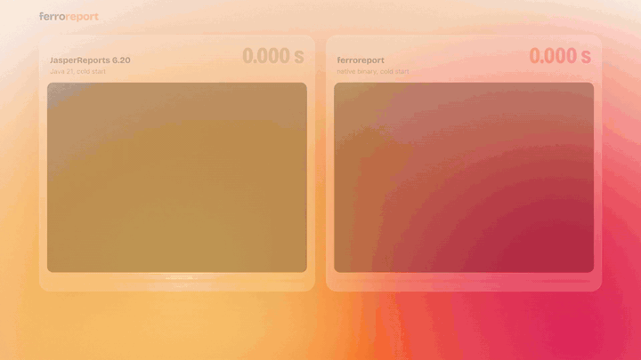

# ferroreport

**Reports in milliseconds, from any language.** ferroreport is a report engine: give it a
template and your data and it writes the PDF, the Excel workbook, the Word document, the
PowerPoint presentation, the OpenDocument spreadsheet or text, the CSV or a web preview. An invoice takes
**3 ms**; a **million rows** take 18 seconds and **19 MB of memory**, because rows are read as
they are needed and pages are written as they are finished. It is one small binary with no
runtime to install, and templates **cannot run code** on your server.

It reads the JasperReports templates (`.jrxml`) you already have and gives the same output,
**pixel for pixel**, so you can design in Jaspersoft Studio and switch engines without touching
a report. Or write templates in [its own format](#templates-jrxml-or-ferro), half the size of
JRXML and accessible by default. Against JasperReports itself it is about **200× faster from a cold start** and
**3 to 5× faster than a JVM that is already warm** ([the numbers](#performance)).

<p align="center"><a href="https://cristianencarnacion.github.io/ferroreport/"></a></p>

**[Try it in your browser](https://cristianencarnacion.github.io/ferroreport/)** ·
[Design a report](https://cristianencarnacion.github.io/ferroreport/designer/) ·
[Download](https://github.com/cristianEncarnacion/ferroreport/releases) ·
[Docker](https://github.com/cristianEncarnacion/ferroreport/pkgs/container/ferroreport) ·
[Leer en español](README.es.md)

> Status: **stable since 1.0; the latest release is 1.3.0** ([what each release brought](CHANGELOG.md)).
> All 48 comparable test templates render pixel for pixel like JasperReports 6.20, including band splitting, images (SVG too), subreports, tables, lists,
> crosstabs, QR, PDF417, Barbecue and other barcodes, links, styled text and multi-column
> layouts; charts are drawn as JasperReports 7 draws them (21 of its 24 chart samples come out
> the same). All 49 that can be exported by both engines
> give the same Excel and CSV files, all 51 pass veraPDF's PDF/UA-1, PDF/A-2a, PDF/A-3b and
> (signed) PDF/A-2b checks, and JasperReports' own samples are checked against 6.20.6 and
> 7.1.1. `ferroreport doctor` tells you whether everything in your template is supported; what
> is not yet is listed under [compatibility](#compatibility). From 1.0 on, versions follow
> [semantic versioning](#stability). Not affiliated with Jaspersoft or Cloud Software Group.

## Why

- **Fast, and flat in memory.** One ~8 MB binary (fonts included) that starts in milliseconds,
  which matters for CLIs, serverless functions and containers. Rows stream in and pages stream
  out: a report of a million rows uses the memory of a report of ten.
- **Identical output.** Every fixture is rendered by both engines and compared pixel by pixel,
  and its Excel and CSV exports cell by cell (see [how output is verified](#how-output-is-verified)).
- **PDF, Excel, Word, PowerPoint, OpenDocument, CSV and HTML.** The same template gives a PDF
  (tagged for screen readers if you want, PDF/UA-1), an `.xlsx` workbook laid out like
  JasperReports' (merged cells, fonts, fills, borders, row heights, images, charts), a `.docx`
  laid out like Jasper's Word export, a `.pptx` with a slide per page, `.ods` and `.odt` files
  for LibreOffice laid out the same way, a CSV, or a web
  page that looks like the PDF, for previews in a browser. Links, anchors and
  bookmarks work in all of them.
- **PDFs to archive, send and protect.** PDF/A-2 and PDF/A-3 (levels a, b and u), checked with
  veraPDF on every push; files carried inside the PDF, such as the XML of an electronic
  invoice; AES-256 encryption with a password and permissions (print, copy, modify...). All of
  it in the open-source engine, from template properties JasperReports already uses or from
  one option.
- **Safe with untrusted templates.** JasperReports compiles template expressions to Java and
  loads serialized `.jasper` files, which is how recent remote-code-execution bugs happened
  (CVE-2025-10492, CVE-2026-6009). ferroreport never deserializes objects and interprets
  expressions from a fixed allow-list: no reflection, no class loading, no network access. Images
  and subreports are only read from the template's resource directories, and limits on nesting,
  image size, subreports, pages, rows and time keep a hostile template from exhausting memory or
  time. Every push mutates each test template thousands of ways and requires an error or a
  document, never a crash ([SECURITY.md](SECURITY.md)).
- **JRXML, or a format of its own.** Templates from Jaspersoft Studio work as they are (JRXML 6
  and 7). New ones can be written in `.ferro`, an outline a person can read and write by hand,
  with no coordinates if you like: parts stack and sit in rows, and what repeats is defined
  once. `ferroreport convert` turns one format into the other, and JRXML 6 into 7.
- **Move a whole project at once.** `ferroreport migrate reports/` checks every template of a
  folder (does it load, what does it use, what is not supported yet, does it render), writes
  the result as Markdown or JSON and, if you ask, the converted templates. Give it your
  JasperReports jars (`--jasper lib/`) and it renders every template with both engines from
  the same rows and compares pages, every text and number, every page's pixels (with
  `pdftoppm` on the PATH) and times. The
  [migration guide](https://cristianencarnacion.github.io/ferroreport/migrate.html) goes through
  a JasperReports project step by step: scriptlets, `.jasper` files, the Java call, data
  sources and exports.
- **Use it from any language.** Packages for JavaScript (Node.js, Deno, Bun, browsers), Python
  and Java, a Rust library, a CLI, and an HTTP API in a Docker image for everything else (C#,
  PHP, Go, Ruby...).

## Use it from your language

> **[Full documentation](https://cristianencarnacion.github.io/ferroreport/docs.html)**: every command, endpoint, function and option.
> Available now: the [npm package](https://www.npmjs.com/package/ferroreport), the
> [PyPI package](https://pypi.org/project/ferroreport/), the Java library on Maven Central
> (`io.github.cristianencarnacion:ferroreport`), the
> [crates](https://crates.io/crates/ferroreport), the
> [release binaries](https://github.com/cristianEncarnacion/ferroreport/releases) and the Docker image.

**JavaScript / TypeScript** (Node.js, Deno, Bun, browsers): `npm install ferroreport`

```js
import { render, convert } from "ferroreport";
const pdf = render(jrxmlSource, rows, { CUSTOMER: "Distribuidora Caribe" }, { locale: "es_DO" });
const xlsx = render(jrxmlSource, rows, params, { format: "xlsx" }); // or "docx", "pptx", "ods", "odt", "csv"
const ferro = convert(jrxmlSource, "ferro"); // the template in ferroreport's own format
```

**Python**: `pip install ferroreport`

```python
import ferroreport
pdf = ferroreport.render("invoice.jrxml", rows, {"CUSTOMER": "Distribuidora Caribe"}, locale="es_DO")
ferroreport.render_to_file("invoice.jrxml", "invoice.xlsx", rows)  # format from the extension
# A file of rows larger than memory, written page by page:
ferroreport.render_to_file("sales.jrxml", "sales.pdf", data_file="sales.jsonl")
```

**Java** (Quarkus, Spring, plain Java 11+; [details](bindings/java/README.md)):

```java
Ferroreport reports = Ferroreport.local();
byte[] pdf = reports.template(Path.of("invoice.jrxml")).rows(lines).param("CUSTOMER", "Caribe").render();
// A query straight to a file, in constant memory:
reports.template(Path.of("sales.jrxml")).rows(resultSet).renderTo(Path.of("sales.pdf"));
```

**Any language, over HTTP** (C#, PHP, Go, Ruby...):

```bash
docker run -p 8080:8080 -v "$PWD/templates:/templates" -e FERROREPORT_TEMPLATES=/templates \
  -e FERROREPORT_TOKEN=change-me ghcr.io/cristianencarnacion/ferroreport

curl -X POST localhost:8080/render/invoice -H 'Authorization: Bearer change-me' -H 'Content-Type: application/json' \
  -d '{"data": [{"item": "Cemento", "amount": 395}], "params": {"CUSTOMER": "Caribe"}}' -o invoice.pdf
```

`POST /render` also accepts the template itself (`{"template": "<jasperReport...", "data": ...,
"resources": {"logo.png": "<base64>"}}`); add `"format": "xlsx"`, `"docx"`, `"pptx"`, `"ods"`, `"odt"`, `"csv"` or
`"html"` (or `?format=xlsx`) for Excel, Word, PowerPoint, OpenDocument, CSV or a web preview. `POST /inspect` reports unsupported features, `GET /health` is there for
load balancers and `GET /metrics` for Prometheus. The server will not listen beyond localhost
without a token (`FERROREPORT_TOKEN`), unless you say the port is private
(`FERROREPORT_ALLOW_ANONYMOUS=1`); `--rate-limit` caps the requests per minute of one client. Templates are parsed once and cached, and every render runs under a time limit (60 s
unless you change `--timeout`) and, if you set them, a page limit (`--max-pages`) and a row limit (`--max-rows`). Every response
carries `X-Request-Id` (the client's own, or a new one), and `--access-log json` (or
`FERROREPORT_ACCESS_LOG=json`) prints one JSON line per request for log platforms: the request
ID, status and time, the template, format, pages, rows and bytes, and the error. It never has
the token, the body, parameter values or rows, except that an error message can quote the value
that could not be read. [The fields](https://cristianencarnacion.github.io/ferroreport/docs.html#http-log).

For reports with more rows than you want in memory, send them one per line
(`Content-Type: application/x-ndjson`: the request on the first line, a row on each line after
it) and the server reads them as the report needs them: a million rows with the server at
about 50 MB. The answer is the whole document or an error, never half a PDF; add
`Prefer: respond-streaming` to get it as it renders instead (first bytes at once, and a client
that leaves stops the render). [How both work](https://cristianencarnacion.github.io/ferroreport/docs.html#http-large).

**Rust**: `cargo add ferroreport` (example below). **Command line**: download a binary from
[Releases](https://github.com/cristianEncarnacion/ferroreport/releases) or `cargo install
ferroreport-cli`; `-d -` and `-o -` read rows from stdin and write the PDF to stdout, which
makes it easy to call from scripts.

Language packages are published by the [release workflow](RELEASING.md).

## Quick start

```bash
cargo install --path crates/ferroreport-cli

ferroreport render invoice.jrxml --data rows.json --params params.json -o invoice.pdf
ferroreport render invoice.jrxml --data rows.json -o invoice.xlsx   # Excel (or .docx, .pptx, .ods, .odt, .csv, .html)
ferroreport doctor invoice.jrxml     # what in this template is (not yet) supported
ferroreport migrate reports/ --report migration.md   # the same for a whole folder
ferroreport migrate reports/ --jasper jasper/lib --strict   # and compared with JasperReports itself
ferroreport migrate reports/ --jasper jasper/lib --strict --strict-pixels   # failing too when a page looks different
ferroreport convert invoice.jrxml -o invoice.ferro   # the same template in ferroreport's format
```

`rows.json` is a JSON array of objects, or one JSON object per line, whose keys match the
template's `<field>` names (dotted names such as `customer.name` reach into nested objects).
The file is read as the report needs it and each page is written as it is finished, so it can
be far larger than memory; `--max-pages`, `--max-rows` and `--timeout` stop a report that grows
past what you expect (`--max-rows` counts the rows of subreports and datasets too, and stops a
summary over a million rows, which prints a single page). Values are converted to the
class each field declares (`java.math.BigDecimal`, `java.util.Date` from ISO-8601 strings,
`java.util.List` from nested arrays, `byte[]` from base64, ...).

Images and subreports are looked up next to the template (add more directories with
`--resources DIR`). A subreport that names `lines.jasper` is rendered from `lines.jrxml` (or
`lines.ferro`): compiled `.jasper` files are never loaded. Nested JSON arrays feed subreports, for example
`new JRMapCollectionDataSource($F{lines})` or
`((JsonDataSource)$P{REPORT_DATA_SOURCE}).subDataSource("lines")`.

As a library:

```rust
let template = std::fs::read_to_string("invoice.jrxml")?;
let rows: serde_json::Value = serde_json::from_str(&std::fs::read_to_string("rows.json")?)?;
let pdf = ferroreport::Renderer::new()
    .locale("es_DO")
    .render_json(&template, &rows, &serde_json::json!({ "CUSTOMER": "Distribuidora Caribe" }))?;
std::fs::write("invoice.pdf", pdf)?;
// Excel, Word, PowerPoint, ODS, ODT or CSV: render_json_as(&template, &rows, &params, ferroreport::Format::Xlsx)
```

For large reports, give it the rows as they come and somewhere to write, and nothing is held
in memory but the page being filled:

```rust
let report = ferroreport::parse(&template)?;          // parse once, render many times
let rows = ferroreport::JsonRows::new(&report, std::fs::File::open("sales.json")?);
let out = std::io::BufWriter::new(std::fs::File::create("sales.pdf")?);
let stats = ferroreport::Renderer::new()
    .limits(ferroreport::Limits { max_pages: Some(50_000), timeout: Some(std::time::Duration::from_secs(120)) })
    .render_to(&report, Box::new(rows), Default::default(), ferroreport::Format::Pdf, out)?;
println!("{} pages from {} rows", stats.pages, stats.rows);
```

`rows` is any iterator of records, so they can come from a database cursor or a queue just as
well; and `fill_to` hands each finished page to a `PageSink` of your own.

### PDF/A, attachments, signatures, encryption and links

```bash
ferroreport render invoice.jrxml -d rows.json -o invoice.pdf --pdfa 3b --attach invoice.xml
FERROREPORT_SIGN_PASSWORD=... ferroreport render invoice.jrxml -d rows.json -o invoice.pdf --sign-key company.p12 --sign-reason "Approved"
ferroreport render payslip.jrxml -d rows.json -o payslip.pdf --user-password 0423 --permissions print
```

- `--pdfa 2b` (or `2u`, `2a`, `3b`, `3u`, `3a`) writes PDF/A: every font inside the document, an
  sRGB output intent, the conformance in the metadata; level a also tags it. A text in a PDF
  standard font is an error, as in JasperReports. The template's
  `net.sf.jasperreports.export.pdfa.conformance` property asks for the same.
- `--attach file[:mime/type]` carries a file inside the PDF (PDF/A-3 allows any file; PDF/A-2
  refuses them).
- `--sign-key` signs the PDF: PAdES baseline B-B (a CAdES detached signature over the whole
  file, with the signer's certificate bound to it), which Adobe Reader, EU validators and
  `pdfsig` accept. The key is a `.p12`/`.pfx` (both the AES files of OpenSSL 3 and the older
  Triple DES/RC2 ones) with its password in `FERROREPORT_SIGN_PASSWORD`, or a PEM key (RSA or
  ECDSA P-256) with `--sign-cert cert.pem` for the certificate and its chain;
  `--sign-reason`, `--sign-location`, `--sign-name` and `--sign-contact` fill in the details.
  It goes with PDF/A (every fixture is signed as PDF/A-2b, checked by veraPDF, then verified by
  pdfsig and pyHanko on every push), not with encryption. `serve --sign-key` signs every PDF it
  sends. In Rust, implement `ferroreport::sign::Signer` (a hardware token, a signing service)
  and pass it to `Renderer::sign`; the key never has to reach ferroreport.
- `--user-password` encrypts the PDF with AES-256 (PDF 2.0's security handler) and asks for that
  password to open it; `--owner-password` lifts the permissions; `--permissions` lists what
  readers allow without it (`print`, `copy`, `modify`, `annotate`, `fill`, `accessibility`,
  `assemble`, `all`). Passwords can come from `FERROREPORT_PDF_USER_PASSWORD` and
  `FERROREPORT_PDF_OWNER_PASSWORD` instead, which keeps them out of the list of processes. The
  template's `net.sf.jasperreports.export.pdf.encrypted`, `user.password`, `owner.password`,
  `permissions.allowed` and `permissions.denied` do the same. A tagged PDF always lets screen
  readers in; PDF/A and encryption do not go together.
- Hyperlinks (`hyperlinkType` Reference, LocalAnchor, LocalPage, RemoteAnchor, RemotePage, with
  their tooltips), anchors and bookmarks (`bookmarkLevel`, which becomes the PDF outline) work
  in PDF, Excel, Word, PowerPoint and HTML, as in JasperReports.

The packages and the server take the same options: `pdfa`, `attachments`, `password`,
`owner_password` / `ownerPassword` and `permissions`.

### Rows from a database

A template's own SQL query runs the way JasperReports runs it over JDBC: `$P{}` values are sent
as bound parameters, `$P!{}` is pasted into the SQL text, and `$X{IN, column, PARAM}` (with
`NOTIN`, `EQUAL`, `NOTEQUAL`, `LESS`, `LESS]`, `GREATER`, `[GREATER` and the `BETWEEN` forms)
becomes the clause it stands for. Subreports, and the subdatasets of tables, lists, crosstabs
and charts, that pass `$P{REPORT_CONNECTION}` run their own SQL query on the same database.
Rows are read as the report needs them, so a large result is never in memory whole. The
database is given by the command line (`--db`), the HTTP server (`serve --db`) and the Rust
library (`Renderer::connection`); the JavaScript, Python and Java packages take the rows from
you instead (a Java `ResultSet` is read row by row). In Java, `Ferroreport.server(...).named(...)`
renders a template of a server started with `--templates` and `--db`: the rows come from you
and its subreports and subdatasets query the server's database.

```bash
ferroreport render sales.jrxml --db postgres://reports@db:5432/erp -p params.json -o sales.pdf
ferroreport render sales.jrxml --db mysql://reports@db:3306/erp -o sales.xlsx
ferroreport render sales.jrxml --db "jdbc:sqlserver://db:1433;databaseName=erp;user=reports" -o sales.pdf
ferroreport render sales.jrxml --db sqlite:app.db -o sales.pdf
```

The drivers are PostgreSQL, MySQL and MariaDB, SQL Server and SQLite. The URL can be written
the way a JasperReports project already has it (`jdbc:postgresql://...`). Put the password in
`FERROREPORT_DB_PASSWORD` rather than in the URL, where the process list would show it, and
use a database user that can only read: the query runs as the template wrote it. For
PostgreSQL, `sslmode` works as it does in `psql`: `prefer` (the default) and `require` encrypt
without checking the certificate, `verify-full` checks it (against `sslrootcert` when given).
`serve --db` gives the database to the templates of `--templates` only: a template sent in a
request never gets it, and a request cannot set a parameter that is pasted into a query
(`$P!{}`). The same fixture renders the same from SQLite, PostgreSQL and MariaDB, and the same
as JasperReports given those rows. In Rust, implement `ferroreport::sql::Connection` for your
own pool and call `Renderer::connection` and `Renderer::render_query_to`.

Queries in other languages (HQL, XPath, MDX, MongoDB...) and other databases (Oracle) are not
run: hand the engine the rows your application reads, as they come:

```bash
# PostgreSQL: one JSON object per row, straight into the report
psql -At -c "select row_to_json(s) from (select * from sales order by region) s" mydb \
  | ferroreport render sales.jrxml -d - -o sales.pdf

# SQLite and MySQL
sqlite3 -json app.db "select * from sales order by region" | ferroreport render sales.jrxml -d - -o sales.pdf
mysql -N -B -e "select json_object('region', region, 'amount', amount) from sales" mydb \
  | ferroreport render sales.jrxml -d - -o sales.pdf
```

```java
// Java: the ResultSet is read as the report needs it
reports.template(Path.of("sales.jrxml")).rows(statement.executeQuery("select * from sales")).renderTo(Path.of("sales.pdf"));
```

```python
# Python: any cursor or generator
cursor.execute("select region, amount from sales order by region")
rows = (dict(zip(("region", "amount"), r)) for r in cursor)
ferroreport.render_to_file("sales.jrxml", "sales.pdf", rows)
```

```python
# pandas: hand over the DataFrame as JSON text. to_json writes NaN as null and dates as
# ISO-8601; to_dict("records") would keep NaN, which is not valid JSON.
pdf = ferroreport.render("orders.jrxml", df.to_json(orient="records", date_format="iso"))

# Polars: to_dicts() gives plain Python values (None for nulls, datetime.date for dates)
pdf = ferroreport.render("orders.jrxml", df.to_dicts())

# SQLAlchemy: rows as dicts; a generator is read one row at a time
from sqlalchemy import text

with engine.connect() as conn:
    result = conn.execute(text("select id, customer, placed, total from orders order by id"))
    pdf = ferroreport.render("orders.jrxml", (dict(row) for row in result.mappings()))
```


### Excel and CSV

The XLSX and CSV exports follow JasperReports' own exporters with their default settings, so a
spreadsheet made from a template looks the way it did with Jasper:

- All pages go on one sheet named after the report. Element edges and page margins cut the page
  into columns and rows; each text takes the cells it covers (merged), with its font, colors,
  borders, alignment and rotation; styled and HTML text keeps its runs.
- Lines become cell borders, rectangles and frames fill and outline their cells, and images sit
  over their cells with the same scale mode and alignment. Charts and barcodes are drawn as
  pictures (at twice Jasper's resolution, so they stay sharp).
- Values are written as the formatted text, like Jasper. Pass `--xlsx-numbers` (or
  `XlsxOptions { detect_cell_type: true }`) to write numbers as numbers with their format.
- CSV has one row for every line where a text starts, and one field for every column where a
  text starts on that page.

### PowerPoint (PPTX)

`-o report.pptx` (`Format::Pptx`, `format="pptx"`, `Format.PPTX`) writes a presentation laid
out like JasperReports' PPTX exporter: each page is a slide of the report's page size, and each
element is a shape where it is on the page.

- Texts are text boxes with their fonts, sizes, bold, italic, underline, strike-through,
  colors, highlight, superscript and subscript, alignment, padding, background, line spacing
  and rotation (left, right, upside down); styled and HTML text keeps its runs.
- Rectangles (rounded too), ellipses and lines are shapes with their fill and pen (solid,
  dashed, dotted, double); frames are rectangles under their elements. A box whose four
  borders are the same is the shape's outline; borders that differ by side are drawn as lines
  (Jasper's exporter leaves those out).
- Images are pictures, each stored once however often it is used, cut to the element as in
  the PDF; charts and barcodes are drawn as pictures (at twice Jasper's resolution).
- Links to web pages and other files work, and links to a page or an anchor of the report jump
  to its slide (Jasper's exporter leaves those out). Slides are written as the pages are filled.
- Not yet: exporter properties (`net.sf.jasperreports.export.pptx.*`, such as a page used as
  the slide master), and fonts embedded in the file. Text is wrapped by PowerPoint or
  LibreOffice with their own font metrics, so a line that just fits in the PDF can wrap there.

### OpenDocument (ODS and ODT)

`-o report.ods` and `-o report.odt` (`Format::Ods`, `Format::Odt`, `format="ods"`...) write the
files LibreOffice and other OpenDocument applications open, laid out the way JasperReports'
ODS and ODT exporters lay a report out:

- ODS is the XLSX grid: every page on one sheet, the same columns, rows, merged cells, fonts,
  colors, borders, padding, alignment and rotation, images over their cells, charts and
  barcodes as pictures. `--xlsx-numbers` (`XlsxOptions { detect_cell_type: true }`) writes
  numbers as numbers here too, with a number style made from their pattern (decimals,
  grouping, percent, scientific, text around them), and dates and times as dates and times
  when their pattern is all digits (days, months, four-digit years, 24-hour times and text
  around them; a pattern with month or day names, AM/PM, a two-digit year or milliseconds
  stays text).
- ODT is the DOCX layout: a table per page with its own columns, each element in the cells
  it covers, pages after the first on a new page. Ellipses and slanted lines are drawn as
  pictures; rectangles and straight lines become cell backgrounds and borders.
- The page has the report's size and orientation; its margins are cells of the grid, as in
  Jasper. Links, anchors and page anchors carry over.
- Not yet: exporter properties (`net.sf.jasperreports.export.ods.*`, `.odt.*`), dates as date
  cells, the per-mille sign in number styles (such values stay text), and upside-down text in
  ODT (Writer's table cells have no such direction; it is written unrotated).
- Large reports are written as they are made, in about the memory of a small one. A
  document's styles come before its body in the file, so a large report is filled once more
  first to find them (a spreadsheet three times in all: its columns, its styles, its rows; a
  text twice), and the rows are then compressed and written as they come: 100,000 rows take
  69 MiB as ODS and 39 MiB as ODT, a million rows 41 MiB as ODT (1.1.0 kept the body in
  memory: 253, 265 and 1,672 MiB). Like large workbooks, this needs rows that can be read
  again: a file, or rows the command line, the server and Python put aside for you; in Rust,
  `render_rows_to`. Rows that can only be read once still give the document, kept in memory
  until it is written.

## Templates: JRXML or .ferro

ferroreport reads JRXML as JasperReports 6 and 7 write it, and a format of its own, `.ferro`:
the same reports, written as an indented outline instead of XML. It is about half the size of
the JRXML, a person can write it without a designer, and its reports are accessible by default.

To make a template without writing it, use the **[designer](https://cristianencarnacion.github.io/ferroreport/designer/)**: it runs in the
browser (nothing is uploaded), in English or Spanish: it lists the fields of a sample of your
data, lets you drag them onto the page and style them, writes text with fields as
`Invoice {number}` instead of code, shows the PDF in its preview, downloads it as PDF, Excel or
Word, and saves `.ferro` and `.jrxml`.

```text
report "Employees" lang=en
  style Base default fontName="DejaVu Sans" size=10
  field salary Double
  variable total Double calculation=Sum : {salary}

  title 40
    h1 0,0 555x30 size=18 : Employees
  columnHeader 20
    text 0,0 300x20 bold : Name
    text 300,0 255x20 bold align=right : Salary
  detail 20
    text 0,0 300x20 : {name}
    text 300,0 255x20 pattern=#,##0.00 align=right : {salary}
  summary 20
    text 300,0 255x20 bold pattern=#,##0.00 align=right : $V{total}
```

Each line is one part of the report: what it is (for an element, its kind), then its position
and size (`x,y` and `widthxheight`), its attributes (`name=value`, quoted when the value has
spaces; a name alone means `true`), and after ` : ` its text or expression. The lines indented
under it are inside it. A band's height follows its name, and `detail 20` is a detail band 20
points tall. Fields, parameters and variables take their name and class (`String`,
`BigDecimal`, `Date`... need no package). A report is A4 with 20-point margins unless it says
`page=Letter` (or `A3`, `A5`, `Legal`, `612x792`), `landscape` or `margins=30`. A text over
several lines goes under a line that ends in ` :`, one level further in. Lines that start with
`//` are comments. Everything JRXML 7 can say, `.ferro` can say: what has no shorthand keeps
its JRXML name (`box`, `pen lineWidth=0.5`, `component`...).

**Text and fields.** `text` prints what follows ` : `. Where it has `{name}`, that is the value
of the field `name` (`text : Invoice {number} · {customer}`); `$P{}` and `$V{}` work the same,
and a text that starts with `=` is an expression (`text : ={qty} * {price}`). A field written
as `{name}` needs no `field` line; declare it when it is used in arithmetic or a condition, or
to give it a class. `color=`, `background=`, `align=`, `valign=` and `size=` are the plain
names of `forecolor`, `backcolor`, `hTextAlign`, `vTextAlign` and `fontSize`, and colors can
be named (`red`, `gray`...). The JasperReports forms (`staticText`, `textField`, `$F{name}`,
`hTextAlign=Right`) keep working.

**Without coordinates.** Positions and sizes can be left out. Parts without `x,y` go one under
the other, as wide as the band, and the band grows to hold them; `row` puts parts side by side,
each with a width in points (`100`), a share (`40%`) or a fraction of what is left (`2fr`,
`1fr`); `stack` puts parts one under another inside a row; `gap=` sets the space between them
(4 points unless you say). A part placed this way moves down when the one above it grows, and a
text field grows with its text, so nothing overlaps.

**Definitions.** What repeats is written once: `def money value` followed by its parts, then
`use money 1fr value=$F{salary}` wherever it goes; `{{value}}` stands for what `use` passes, and
other attributes on `use` go to the parts.

```text
report "Employees" lang=en
  field salary Double

  def money value
    textField pattern=#,##0.00 align=right : {{value}}

  title gap=6
    h1 height=30 size=18 : Employees
  detail
    row height=16
      text 3fr : {name}
      use money 1fr value={salary}
```

**Logic.** `if : condition` shows its parts only when the condition holds, and takes no room
when it does not; `each : $F{lines}` repeats its parts for every row of a nested list, whose
fields are declared inside it; `import "parts.ferro"` brings in another file's definitions and
styles (read from the template's folder or the resource folders).

```text
report "Invoices" lang=en
  import "parts.ferro"
  field overdue Boolean
  field lines List
  detail gap=2
    text bold : {number}
    if : {overdue}
      text color=#B00020 : Overdue: send a reminder
    each : {lines}
      field qty Integer
      field price Double
      row height=14
        text 3fr : {product}
        use money 1fr value="{qty} * {price}"
```

They become what JasperReports knows (a frame with `printWhenExpression` and
`removeLineWhenBlank`, a list component over a subdataset), so the converted JRXML runs in
JasperReports too: [examples/invoices.ferro](examples/invoices.ferro) renders the same in both,
pixel for pixel.

`ferroreport convert` writes the result as JRXML with every coordinate worked out, so Jaspersoft
Studio and JasperReports open it as any other report ([the whole example](examples/employees.ferro),
which JasperReports 7.1.1 renders pixel for pixel like ferroreport).

**Accessible by default.** A `.ferro` report produces a tagged PDF that screen readers can
follow (unless it says `tagged=false`), in the language of `lang=`. `h1` to `h6` are headings,
`alt="..."` describes an image, and `tag=th` (or any other tag) says what an element is.

`ferroreport convert` turns one format into the other, and JRXML 6 into JRXML 7:

```bash
ferroreport convert invoice.jrxml -o invoice.ferro     # JRXML 6 or 7 -> .ferro
ferroreport convert invoice.ferro -o invoice.jrxml     # .ferro -> JRXML 7 (Jaspersoft Studio 7 opens it)
ferroreport convert old.jrxml --to jrxml -o new.jrxml  # JRXML 6 -> JRXML 7
```

Every way of rendering reads `.ferro` like JRXML: the CLI (`ferroreport render invoice.ferro`),
the packages (pass the template's text or file), the server (`POST /render/invoice` finds
`invoice.ferro` when there is no `invoice.jrxml`), subreports and style templates. The Python
and JavaScript packages have `convert(template, to)` too.

How the conversions are checked: JasperReports ships its samples written in JRXML 6 (6.20)
and in JRXML 7 (7.1.1, converted by JasperReports' own tools). `tools/convert_check.py`
converts the 123 samples that are in both and compares the result with JasperReports' own
JRXML 7: 89 are the same, and the other 34 are samples that were edited between the two
releases (a text, a margin, a property added), apart from one custom component of a sample's
own. All 171 JRXML 7 samples go to `.ferro` and back unchanged (two with their properties in
another order). Every fixture renders to the same pixels from its JRXML, its JRXML 7 and its
`.ferro`, and JasperReports 7.1.1 renders the converted fixtures.

## Compatibility

| Area | Supported | Not yet |
|---|---|---|
| Templates | JRXML 6.x schema; JRXML 7 as JasperReports 7 writes it; `.ferro` (ferroreport's own format), with `ferroreport convert` between them; subdatasets (for tables, lists, crosstabs and charts), with their SQL query run on `$P{REPORT_CONNECTION}` (see [Rows from a database](#rows-from-a-database)); style templates (`<template>`, `.jrtx` files, with the templates they include, found next to the report or in a resource folder) | `.jasper` files (by design), scriptlets |
| Bands | title (going on over several pages when it does not fit one, as in JasperReports), page header/footer, column header/footer, detail (multiple bands), summary, no data, background, last page footer; splitting bands across pages (`splitType` Stretch, Prevent, Immediate; a summary with Immediate starts on the page where the one before it ends); multi-column layout (vertical and horizontal print order, `isStartNewColumn`, column breaks); with no rows and `AllSectionsNoDetail`, group headers and footers print once | |
| Elements | static text, text field, line, rectangle (rounded), ellipse, frame (split across pages), image (PNG, JPEG or GIF from files, base64 or `byte[]`), subreport, crosstab (row and column groups with totals at the start or end, header positions, several measures with Sum, Count, DistinctCount, Average, Highest, Lowest and First, percentages of the grand total (`percentageOf`), buckets ordered by a total (`orderByExpression`), `$V{measure_group_ALL}` totals, crosstab parameters, data from the report or a subdataset; column parts as wide as the element and rows continuing on the next pages with repeated headers), table component (column groups, table/column/group headers and footers, hidden columns, no-data cell, headers repeated on every page), list component (vertical and horizontal), icon label, charts, barcodes (barcode4j components: QR code, DataMatrix, PDF417, Code 128, EAN-128, Code 39 with full ASCII, EAN-13, EAN-8, UPC-A, UPC-E, Interleaved 2 of 5, Codabar, POSTNET, Royal Mail and USPS Intelligent Mail; Barbecue components: every type but PostNet, rotated), hyperlinks, anchors and bookmarks, PDF form fields (`net.sf.jasperreports.export.pdf.field.*`: text, combo and list boxes, check boxes, radio buttons), page break (applied after its band) | crosstab bucket comparators, crosstabs over a group's rows, UPC/EAN add-ons, rotated barcode4j barcodes, Barbecue's PostNet (Barbecue draws it as bars of one height; barcode4j's POSTNET is drawn), maps and other custom components |
| Text | wrapping, stretch with overflow, padding, borders, left/center/right/justified alignment, all line-spacing modes, paragraph indents (first line, left, right) and tab stops (the default ones every `tabStopWidth` points and custom left, center and right stops), laid out as JasperReports lays them out, segment by segment, underline, strike-through, `isBlankWhenNull`, styled, HTML and RTF markup (bold, italic, underline, strike-through, fonts, sizes, colors, highlight, superscript, subscript, line breaks; HTML lists, bulleted and numbered, nested), also across page breaks; rotation (Left, Right, UpsideDown); cutting a text that does not fit at a character and with a suffix (`net.sf.jasperreports.text.truncate.*`); right-to-left text (Arabic, Hebrew) in the Unicode Bidirectional Algorithm's order, numbers and Latin inside it included, running right to left as JasperReports decides it (a paragraph that starts with a right-to-left letter) and aligned as JasperReports aligns it; text shaped with harfrust (Arabic letters joined, Devanagari conjuncts and vowel signs, Thai marks, the font's mark positioning) and broken at the Unicode line-break opportunities, in PDF, HTML and the chart pictures of XLSX, DOCX and PPTX; copying from the PDF gives the characters as written; characters the font lacks drawn in another font, with font sets as JasperReports' font extensions define them (`--font-set`) or for every font (`--font-fallback`); hyphenation of long words at line ends when the template asks for it (`ferroreport.text.hyphenate`, ferroreport's own: JasperReports does not hyphenate), in plain text | hyphenation of styled, HTML, right-to-left and complex-script text; Thai, Lao, Khmer and Myanmar break without a dictionary (before a leading vowel, after a syllable-final sign, at spaces); combining accents on Latin letters are drawn one glyph per character, as before |
| Layout | `positionType` Float / FixRelativeToBottom, `stretchType`, `printWhenExpression`, `isRemoveLineWhenBlank`, `isPrintRepeatedValues` (with `isPrintInFirstWholeBand`, `printWhenGroupChanges`), `isPrintWhenDetailOverflows` | |
| Styles | default style (also what styles without a parent inherit from), parent styles, element overrides, conditional styles (up to 4 per style), styles from style templates (a style defined again replaces the earlier one for what comes after, as in JasperReports) | |
| Images | PNG, JPEG and GIF (its first frame, with its transparent color); SVG (drawn as vectors in PDF, as pictures in Excel, Word, PowerPoint and OpenDocument); scale modes RetainShape, FillFrame, Clip, RealHeight and RealSize (the element takes the picture's size, as in JasperReports); alignment; `onErrorType` | remote URLs (by design), other formats |
| Charts | pie, 3D pie, bar, 3D bar, stacked bar (vertical and horizontal), line, area, stacked area, XY line, XY area, XY bar, scatter, bubble, time series, candlestick, high-low, Gantt, meter, thermometer, multi-axis; titles, legends, axis labels, series colors, range limits, tick formats, pie label formats; datasets by record, group, page or report, with `evaluationTime`, and from a subdataset | chart customizers and themes. Charts are drawn as JasperReports 7.1 draws them with JFreeChart 1.5, pixel for pixel in its own samples, except meter charts, whose value label lands a fraction of a point off, and multiple axis charts of XY charts, which follow JFreeChart's look without being the same. JasperReports 6 (JFreeChart 1.0.19) frames the legend and draws 3D charts in 3D, which ferroreport does not; chart text is written as outlines, as JasperReports writes it, so it cannot be selected |
| Subreports | data from nested JSON (`JRMapCollectionDataSource`, `JRBeanCollectionDataSource`, `subDataSource`, `JREmptyDataSource`), subreports that run their own SQL query on `$P{REPORT_CONNECTION}` (with `--db`), parameters, return values, splitting across pages with reprinted column headers | connections built in Java (`DriverManager.getConnection(...)` in an expression) |
| Data | groups (start new page, reprint header, min height), variables: Sum, Count, DistinctCount, Average, Lowest, Highest, First, Nothing, System, StandardDeviation, Variance; reset by report/page/column/group or never (`resetType="None"`); `incrementType` (a count that moves once per group counts groups); group expressions that read variables; evaluation time Now/Report/Page/Column/Group and `Auto` for text (each variable read at its own moment: a group's share of the grand total in one expression), and `Master` with `MASTER_CURRENT_PAGE` and `MASTER_TOTAL_PAGES` (the report's own pages: a subreport's stay null) | queries in languages other than SQL (HQL, XPath, MDX...: pass the rows) |
| Expressions | Java and Groovy subset: literals, `$F/$P/$V`, arithmetic with Java promotion rules (and Groovy's: `5 / 2` is a BigDecimal 2.5), string concat, comparisons, ternary, Elvis, casts, common String/Number/BigDecimal/Date/List methods, `Math` (rounding, powers, logarithms, trigonometry), `String.format`, `new SimpleDateFormat(..).format(..)`, `new DecimalFormat(..).format(..)`, `Base64` decoding, `msg(pattern, args...)` (`java.text.MessageFormat`), `$R{key}` and `str("key")` from the report's `resourceBundle` (`.properties` files next to the template or in a resource folder, picked by locale); `new ArrayList()`; the `Locale` getters on `$P{REPORT_LOCALE}` (`getDisplayName`, `getDisplayLanguage`, `getCountry`...); a static field of a class the template declares a parameter or field with is an enum constant (`Greeting.bye` reads as the text `"bye"`); what Java throws as a `NullPointerException` makes the expression null, as in JasperReports; JasperReports' function library as Jaspersoft Studio lists it (`IF`, `AND`, `SUM`, `MAX`, `ROUND_HALF_UP`, `LEFT`, `MID`, `FIND`, `SUBSTITUTE`, `PROPER`, `DATE`, `DATEFORMAT`, `EDATE`, `WORKDAY`, `NETWORKDAYS`, `WEEKNUM`, `TIME` and the rest: 78 functions, 272 cases checked against JasperReports); `DATERANGE("MONTH-1")` and fixed ranges, with `getStart()`/`getEnd()` and in `$X{}` clauses; Groovy lists, maps and ranges (`[1, 2]`, `[a: 1]`, `1..5`), closures given to `findAll`, `collect`, `sum`, `inject`, `sort`, `groupBy` and the rest, `"${...}"` strings, `?.`, `**`, `<=>`, `in`, `as`, indexing, and string helpers (`padLeft`, `tokenize`, `capitalize`...) | arbitrary Java classes (scriptlets, static methods of your own), Groovy statements (`def`, loops, `if` blocks), regular expressions beyond a literal or `\s+` |
| Formatting | `DecimalFormat` patterns (HALF_EVEN), `SimpleDateFormat` patterns; locales en_US, es, es_ES, es_DO, es_MX, es_419 and the other Spanish-speaking countries (es_AR, es_CO, es_CL, es_PE, es_US...; tags Java does not have as es), fr, fr_FR, fr_BE, fr_CA, fr_CH, fr_LU, fr_MA, the CFA and CFP franc countries (fr_SN, fr_CI, fr_CM, fr_NC...) and the other French regions whose formats differ (fr_DZ, fr_TN, fr_HT...; other `fr_` tags as fr_FR), pt, pt_BR, pt_PT (other `pt_` tags as pt_PT), it, it_IT, it_CH (other `it_` tags as it_IT), de, de_DE, de_AT, de_CH (de_LI as de_CH, other `de_` tags as de_DE) | other locales |
| Fonts | DejaVu Sans/Serif/Mono (the `jasperreports-fonts` families) bundled; extra TTF/OTF via `--font`; JasperReports font extensions in a resource folder (a `jasperreports_extension.properties` at its root and the `fonts.xml` files it names, with their font files, as on JasperReports' class path), read by `render` and `check`, or `Renderer::load_font_extensions`; bold and italic text in a registered family without those faces drawn from its regular face, stroked and slanted in PDF as JasperReports (iText) simulates them; font sets (`--font-set Name=Family,Family`), resolved run by run as JasperReports resolves them; text in a font no one provides is written like JasperReports writes it, in the PDF standard font of its `pdfFontName` (Helvetica by default); a character no font has is left out of the PDF, as JasperReports leaves it out | font extensions inside jars |
| Output | PDF, optionally tagged for screen readers (`--tagged`, or the template's `net.sf.jasperreports.export.pdf.tagged` property; `.ferro` reports are tagged by default) and then PDF/UA-1, checked with veraPDF: texts as paragraphs or headings, pictures as figures with their tooltip as description, tables and crosstabs as tables with header cells and the columns and rows each cell spans, HTML lists as lists, links as links; PDF/A-2 and PDF/A-3 (a, b, u), checked with veraPDF; files attached inside the PDF; AES-256 encryption with passwords and permissions; PAdES B-B digital signatures (`--sign-key`); links, anchors and the bookmark outline; XLSX and CSV laid out like Jasper's exporters (default settings); DOCX laid out like Jasper's Word exporter (a table per page, the cells each element covers, its fonts, colors, borders and pictures); ODS and ODT laid out like XLSX and DOCX (as Jasper's ODS and ODT exporters do); PPTX laid out like Jasper's PowerPoint exporter (a slide per page, each element a shape, text box or picture where it is on the page); HTML previews | XLS (old format), signatures with timestamps or long-term validation (PAdES B-T, B-LT), visible signature boxes, exporter properties (`net.sf.jasperreports.export.*`) other than number detection, PDF form fields, the tagged PDF, PDF/A and PDF encryption ones |

QR codes are encoded exactly like ZXing (same version, mask and modules) and are drawn the way
JasperReports draws them, which makes them a good fit for printed electronic invoices (for
example the Dominican e-CF stamp).

Run `ferroreport doctor template.jrxml` to get this verdict for a specific template, or
`ferroreport migrate folder/` for every template of a project. Over the 171 JRXML 7 samples of
JasperReports 7.1.1: all of them load, 163 with everything they use supported (24 of them once you
pass the rows their HQL, XPath, MDX or other non-SQL query gave) and 8 with something not
supported yet: Java code (scriptlets, a chart customizer) or third-party components (spider
chart, XChart, a generic element).

## How output is verified

`tools/compare.py` renders every template in `fixtures/` with JasperReports 6.20.6 and with
ferroreport, rasterizes both PDFs and compares them pixel by pixel. A fixture matches when fewer
than 0.15% of the inked pixels differ (font anti-aliasing noise); most match exactly. Today all
51 comparable fixtures match (07-groovy with a Java 17 runtime, see ¹). Barcode geometry is also checked bar by bar against barcode4j itself
(`crates/ferroreport/tests/barcode4j.rs`) and against Barbecue (`crates/ferroreport/tests/data/barbecue.txt`: 115
barcodes of every type as Barbecue draws them for JasperReports).

`tools/compare_sheets.py` does the same for spreadsheets: both engines export every fixture to
XLSX and CSV, and the worksheet XML, the styles XML and the CSV text must be byte for byte the
same, and every picture anchored to the same cells. All 54 fixtures it can compare pass (48-sql
needs a JDBC driver for the reference; 57-hyphenation differs by design, its row heights following
the hyphenated lines). Jasper's output for five
of them is kept in `fixtures/*/jasper-xlsx/`, so `cargo test` checks them without Java.

`tools/pdfua.sh` renders every fixture as a tagged PDF and checks it against PDF/UA-1 with
veraPDF, the validator the PDF Association maintains, and `tools/pdfa.sh` renders them again as
PDF/A-2a, as PDF/A-3b with a file attached and as signed PDF/A-2b and checks those; they run on
every push, and all 51 pass all four. The signatures are verified with poppler's `pdfsig` and
with pyHanko. Encrypted PDFs are checked by opening them with qpdf and pikepdf: every
fixture decrypts to the same pages and text as without encryption.
Word documents follow JasperReports' DOCX exporter; every fixture's `.docx` opens in LibreOffice
with as many pages as its PDF. So do the `.ods` and `.odt` of the 50 fixtures not filled from a
database (converted to PDF by LibreOffice, headless); about ten of them were also compared with
the PDF by eye. The `.pptx` of every fixture but one opens in LibreOffice Impress with a slide
for each page of its PDF, and the first slide of each was compared with the PDF by eye (about
ten of them closely); 09-large (477 slides, as many shapes as Jasper's PPTX of it) needs more
memory than the 7 GB machine it was checked on, so it was checked rendered from its first
2,000 rows (48 slides). The `.pptx` of the 53 fixtures Jasper renders here (all but 07-groovy
and 48-sql) were also compared with the `.pptx` Jasper's exporter writes: the same number of
slides, and 88,505 of their 88,506 text boxes at the same place, of the same size and with the
same font size (the other, a rotated text, half a point off). The XML of the other formats is
not compared with Jasper's.

| Fixture | What it exercises | Result |
|---|---|---|
| 01-employee-list | list, patterns, page numbers | identical |
| 02-invoice | parameters, BigDecimal math, boxes, stretch, "page X of Y", summary | identical |
| 03-grouped-sales | nested groups, group/page/report totals, averages, distinct counts, zebra rows | identical |
| 04b-stretch-prevent-split | frames, floating elements, stretching text, conditional printing | identical |
| 05-no-data | `whenNoDataType="NoDataSection"` | identical |
| 06-expressions | Java semantics, formatting, variables (First, Lowest, StdDev, BigDecimal average) | identical |
| 07-groovy | Groovy expressions | identical¹ |
| 08-styles-and-shapes | style inheritance, borders, dashes, line spacing, shapes, Unicode | identical |
| 09-large | 20,000 rows, 477 pages | identical |
| 10-band-split-across-pages | a band larger than the space left on the page | identical |
| 11-null-values | null handling | identical |
| 12-group-options | start group on new page, reprinted headers, min height, group-time evaluation, background, last page footer | identical |
| 13-text-overflow | long texts split across pages | identical |
| 14-overflow-cells | split frames, `stretchType`, `isPrintWhenDetailOverflows` | identical |
| 15-images | PNG (RGB, alpha, grayscale), JPEG, scale modes, base64 images | identical |
| 16-layout-features | conditional styles, justified text, `isRemoveLineWhenBlank`, `isPrintRepeatedValues` | identical |
| 17-subreports | subreports over nested JSON, parameters, return values, split across pages | identical |
| 18-barcodes | QR codes (several error-correction levels), Code 128 with and without text | identical |
| 19-columns | three-column layout with groups, column headers/footers, `COLUMN_NUMBER`/`COLUMN_COUNT` | identical |
| 20-columns-summary | summary after a report that ends in the second column | identical |
| 21-markup | styled and HTML markup: mixed fonts, sizes, colors, highlight, superscript, alignment, justification | identical |
| 22-markup-overflow | styled text that continues on the next page | identical |
| 23-rotation | rotated text (left, right, upside down) with padding and alignment | identical |
| 24-charts | pie, 3D pie, bar, stacked horizontal bar, line and area charts | same layout (charts are not compared pixel by pixel) |
| 25-charts-xy | XY line and scatter charts per group (`evaluationTime="Group"`) | same layout (charts are not compared pixel by pixel) |
| 26-barcodes-1d | EAN-13, UPC-A (text on top), EAN-8, Code 39 with check character, Interleaved 2 of 5, Codabar | identical |
| 27-table | Table component as Jaspersoft Studio's wizard builds it: styled cells, column group header, stretching rows, column footers and table footer, a table spanning pages | identical |
| 28-table-groups | Table with subdataset groups (group header/footer cells), nested column groups, a hidden column, multi-row headers, no-data cell | identical |
| 29-list | List component: contact cards with stretching notes, an empty list, a list spanning pages | identical |
| 30-crosstab | Crosstab as Jaspersoft Studio builds it: two row groups and a column group with totals, header cell, styled cells | identical |
| 31-crosstab-pages | Crosstab per detail row over a subdataset: two column groups, totals at the start, descending order, centered headers, Sum/Count/Average measures, crosstab parameter, column parts and rows across pages | identical |
| 32-crosstab-percent | Crosstab with percentages of the grand total (BigDecimal and Integer) and regions ordered by their total sales | identical |
| 33-page-x-of-y | "Page X of Y", a grand total in the title and group totals in group headers: values known only later, added to pages already written | identical |
| 34-late-values-overlap | Late values with something drawn over them (a stamp over a total, a line across a page count): the page waits for the value | identical |
| 35-auto-increment-styles | `evaluationTime="Auto"`, `incrementType`, a group expression that reads a variable, `resetType="None"`, `msg()`, styles without a parent | identical |
| 36-no-rows-groups-offsets | No rows with `AllSectionsNoDetail`: group header and footer print once; PDF page offsets for binding | identical |
| 37-page-offsets | Odd and even pages moved in opposite directions (`net.sf.jasperreports.export.pdf.odd.page.offset.x` and siblings) | identical |
| 38-style-templates | Styles from a `.jrtx` that includes another, a style redefined, a conditional style in a template, the report's own style over a template's | identical |
| 39-horizontal | `printOrder="Horizontal"`: records across a row of columns, group bands on rows of their own, a detail band that does not grow | identical |
| 40-horizontal-new-page | Horizontal order with `isStartNewColumn` (a new page) and `isReprintHeaderOnEachPage` | identical |
| 41-horizontal-list | A `jr:list` with `printOrder="Horizontal"`: cards side by side, each row as tall as its tallest card | identical |
| 42-split-page-totals | Records whose band is split across pages, counted in the page totals where they start; group headers reprinted in a group footer's page break | identical |
| 43-title-overflow | A title taller than its page, going on over the next pages without page headers or footers | identical |
| 44-pdf417 | PDF417 barcodes: error-correction levels, column and row limits, width-to-height ratio | identical |
| 45-svg-images | SVG images: scale modes, sizes without units and in millimeters, gradients | identical |
| 46-links | Links to web addresses, anchors, pages and an anchor in another file (with a tooltip), named anchors, bookmarks at two levels | identical |
| 47-barbecue | Barbecue barcodes: Code 128 (automatic and C), Code 39 with check character, EAN-13, UPC-A, 2 of 5 interleaved and standard, Codabar, EAN-128, SSCC-18, rotated left, right and upside down, one per row | identical |
| 48-sql | The report's SQL query with `$P{}`, `$P!{}` and `$X{IN}`, and a subreport that runs its own query per row on `$P{REPORT_CONNECTION}` | identical² |
| 49-functions | 265 expressions of JasperReports' function library (`IF`, `SUM`, `DATEFORMAT`, `WORKDAY`, `DATERANGE`...) | identical |
| 50-barbecue-types | The other Barbecue types: USPS, SCC-14, GTIN, shipment number, UCC-128 with its application identifier, EAN-128 with a check digit, random-weight UPC-A, Bookland, Code 39 extended, PDF417, a long Code 128 | identical (6.20.6 and 7.1.1) |
| 51-real-size | `scaleImage` RealHeight and RealSize: elements that grow and shrink with their picture, narrowed to their width, aligned, with padding, moved to the next page when they do not fit | identical |
| 52-arabic | Arabic: joined letters, right to left with numbers and Latin inside, left/right/center/justified alignment, wrapped paragraphs, a table of Arabic data | identical |
| 53-hebrew-mixed | Hebrew mixed with numbers, prices, parentheses and Latin; a left-to-right paragraph with Hebrew inside; styled text with Hebrew runs | identical |
| 54-devanagari | Devanagari: conjuncts, reph, vowel signs drawn before their consonant, justified and wrapped text (GNU FreeSerif, from `fonts.txt`) | page count³ |
| 55-thai | Thai: stacked vowels and tone marks, line breaks in text without spaces (GNU FreeSerif) | page count³ |
| 56-font-fallback | Font sets (`fontsets.txt`; the reference run gets the same sets from a font extension in `jasper-extension/`): stars, check marks and circled digits DejaVu Serif lacks drawn in DejaVu Sans, three fonts on one line, bold, italic, justified, right-aligned and styled text, stretching fields; characters no font has, left out as JasperReports leaves them out | identical |
| 57-hyphenation | `ferroreport.text.hyphenate` on the report (the locale's language) and on two subreports (Spanish, off): justified, right-aligned and centered text, a word longer than its line, stretching fields | page count⁴ |
| 58-crosstab-counts | Crosstab built-in variables `ROW_COUNT`, `COLUMN_COUNT`, `IS_EVEN_ROW`, `IS_EVEN_COLUMN` in cells, headers and conditional styles, with row and column totals | identical |
| 59-null-pointer | Expressions that throw a `NullPointerException` (a method on null, null in arithmetic, comparisons and conditions) in fields, a group, variables, print-when expressions and a conditional style | identical |
| 60-font-extension | A JasperReports font extension in `jasper-extension/`, read from that resource folder: a family with its own regular and bold font files (DejaVu Sans Condensed cut down to Latin-1) and a font set over it and DejaVu Serif, in justified, right-aligned and stretching text | identical |
| 61-summary-split | A summary with `splitType="Immediate"` that starts after a tall title and goes on to the next page: floating frames under stretching texts, a frame whose texts do not fit their own height above the page's end and move whole, a hidden frame that removes its line where the summary continues, the page footer on the first page only | identical |
| 62-simulated-styles | A font extension family with a regular face only: bold, italic, bold italic and underlined text drawn from it, stroked and slanted as JasperReports simulates them, also justified, right-aligned, styled and in color | identical |
| 63-paragraphs | Paragraph indents and tab stops: first line, left and right indents from a style and from the element, default stops and custom left, center and right ones, in left, right and centered elements, plain and styled text, with padding, proportional and fixed spacing, words longer than the room left, and tabs in a text without paragraph settings | identical |
| 64-line-gap | A font with a line gap (DejaVu Sans Condensed cut down and renamed, with leading added) from a font extension: the first baseline the gap and the ascent below the top, in plain and styled text, top, middle and bottom aligned, with one and a half and proportional spacing, and in stretching fields | identical |

¹ The reference bundle's Groovy 4.0.8 cannot run on Java 21: set `ORACLE_JAVA_GROOVY` to a
Java 17 runtime and `tools/compare.py` uses it for Groovy templates (the others stay on Java 21,
whose date formats, with a narrow space before AM/PM, are the ones ferroreport follows). The Groovy subset is also checked expression by
expression against JasperReports on Java 17 (`crates/ferroreport/tests/groovy.rs`, 128 cases).

² Filled from SQLite with the template's own query; the reference run would need a JDBC driver,
so it was checked against JasperReports 6.20.6 given the same rows (CSV identical, PDF
pixel-identical), and CI renders it from SQLite, PostgreSQL and MariaDB to the same document.

³ The reference run has no font extension for FreeSerif, so JasperReports' PDF shows no text
for these two: only the page count is compared. Their XLSX and CSV are identical.

⁴ JasperReports does not hyphenate (`ferroreport.text.hyphenate` is ferroreport's own property,
which JasperReports ignores), so only the page count is compared; the parts of the page that are
not hyphenated are identical.

To run it yourself you need a JDK and the JasperReports jars (`jasperreports`,
`jasperreports-fonts` and their dependencies) in one directory:

```bash
cargo build --release
JASPER_LIB=/path/to/jars python3 tools/compare.py      # diff images land in target/compare/
JASPER_LIB=/path/to/jars python3 tools/compare_sheets.py   # XLSX and CSV
JASPER_LIB=/path/to/jars python3 tools/bench_all.py     # every number in the next section
JASPER_LIB=/path/to/jars python3 tools/bench_concurrent.py   # many reports at once
JASPER_LIB=/path/to/jars python3 tools/samples.py      # JasperReports' own samples (below)
```

### JasperReports' own samples

The fixtures above are reports like the ones people write. `tools/samples.py` runs a harder
test that nobody chose with ferroreport in mind: the templates of the `demo/samples` folder of
JasperReports, each rendered by both engines from the same rows and parameters and compared the
same way. They exist to show every feature of JasperReports, one per sample: charts of every
kind, maps, PDF forms, Java scriptlets, queries through a live database connection. Both the
6.20.6 samples (JRXML 6) and the 7.1.1 samples (JRXML 7, rendered by JasperReports 7.1.1) are
checked.

| Result | 6.20.6 | 7.1.1 |
|---|---|---|
| The same pages | 42 | 76 |
| Both render it, the pages differ | 40 | 17 |
| ferroreport refuses it or fails on it | 6 | 8 |
| JasperReports cannot render it from rows and parameters alone (it needs the sample's Java objects, a database connection or other files), so there is nothing to compare | 52 | 70 |

So 42 of the 88 6.20.6 samples that can be compared come out the same, and 76 of the 101 7.1.1
ones (JasperReports 6.20.6 runs on Java 17 there, where its Groovy works). [Every 6.20.6 template with its result and the reason](docs/samples.md), and [every
7.1.1 one](docs/samples-7.1.1.md). Charts are drawn as JasperReports 7.1 draws them: 21 of the
24 7.1.1 chart samples are the same (not the one with a chart customizer, the meter, whose value
label lands a fraction of a point off, and one page of the time period bar chart), while against 6.20.6, whose JFreeChart
frames legends and draws 3D charts, all 24 still differ. The rest are elements that are
not supported (maps, custom components), PDF form
fields, whose look is close but not the same, and expressions that call the sample's own Java
classes, which ferroreport never runs. Rendering these samples is also how differences in how
variables, styles, repeated values, page totals and the height of a band are evaluated were
found and fixed, and why style templates, GIF images, horizontal print order, PDF page offsets,
Helvetica for text without a font, RTF markup, form fields and the remaining chart types are
supported.

## Performance

How much faster depends on what you compare, so here are the comparisons that matter, each of
ferroreport 1.3.0 against JasperReports 6.20.6 on Java 21, on the same 2-CPU Linux machine. One
command reproduces all of it: `tools/bench_all.py` (raw results, with the machine and the
versions, in [docs/benchmarks.json](docs/benchmarks.json)). The machine is shared with other
work, so each run started on an idle machine and a run that other processes took CPU time
from was done again (`--wait-idle`).

The times are higher than the 1.1.0 figures because the machine was slower in this run:
JasperReports itself took 10 to 30% longer. Built on the same machine and run alternately,
1.3.0 is within a few percent of 1.1.0 (8% at most), except Word (DOCX) export of 20,000 rows,
about 17% slower (0.51 s against 0.44 s), and ODS and ODT of 100,000 rows, slower by design since
1.2 in exchange for a fraction of the memory (67 MiB instead of 248, 40 MiB instead of 264). The
peak memory of the same binary also moves by a few MiB with the state of the page cache: the
invoice took 15 MiB in that comparison and 18 MiB in the table below.

**Cold: a process that starts, renders one report and exits.** What a script, a serverless
function or a container per report pays. Time from process start to the PDF on disk, and peak
memory (median of 5 to 7 runs):

| Report | JasperReports | ferroreport | Faster |
|---|---|---|---|
| Invoice, 2 pages | 2.90 s, 195 MiB | 11 ms, 18 MiB | 268× |
| Grouped sales, 4 pages | 3.28 s, 184 MiB | 15 ms, 18 MiB | 214× |
| Arabic, right to left, 1 page | 2.61 s, 171 MiB | 10 ms, 17 MiB | 268× |
| 20,000 rows, 477 pages | 7.33 s, 439 MiB | 0.34 s, 16 MiB | 21× |

**Warm: a service that stays up.** JasperReports at its best: one JVM, the template compiled
once, the JIT warmed up by hundreds of runs, rows already converted to Java objects, the PDF
exported to memory. ferroreport does the whole job each time (parses the template too). Median
time per report:

| Report | JasperReports | ferroreport | Faster |
|---|---|---|---|
| Invoice, 2 pages | 9.0 ms | 2.8 ms | 3.2× |
| Employee list, 2 pages | 6.7 ms | 1.7 ms | 3.9× |
| Grouped sales, 4 pages | 14.2 ms | 4.6 ms | 3.1× |
| Arabic, right to left, 1 page | 5.5 ms | 1.6 ms | 3.4× |
| 20,000 rows, 477 pages | 1401.6 ms | 299.0 ms | 4.7× |

The Arabic report (fixture `52-arabic`) is shaped on every render: letters joined with
harfrust, lines put in right-to-left order with the Unicode Bidirectional Algorithm.

**Many at once: a service under load.** The same warm JVM and the same ferroreport, now with
several threads rendering the invoice at the same time for 8 seconds, on 2 CPUs
(`tools/bench_concurrent.py`, raw results in
[docs/benchmarks-concurrent.json](docs/benchmarks-concurrent.json), which has the grouped sales
report too):

| Threads | Reports/s, JasperReports | Reports/s, ferroreport | 95% under, JasperReports | 95% under, ferroreport | Memory, JasperReports | Memory, ferroreport |
|---|---|---|---|---|---|---|
| 1 | 104 | 350 | 14 ms | 4 ms | 306 MiB | 13 MiB |
| 2 | 127 | 745 | 26 ms | 4 ms | 349 MiB | 13 MiB |
| 10 | 128 | 637 | 121 ms | 23 ms | 418 MiB | 20 MiB |
| 50 | 152 | 703 | 817 ms | 162 ms | 652 MiB | 61 MiB |
| 100 | 138 | 701 | 1993 ms | 347 ms | 712 MiB | 92 MiB |

Three to six times the reports per second at every load, 95% of them finished three and a half
to seven times sooner, in an eighth to a twenty-sixth of the memory. Over HTTP, `ferroreport serve` answers an
invoice in about 3 ms on a connection that is kept open.

**Large: rows by the hundred thousand.** The same report with more rows, cold, JasperReports
with its default heap. ferroreport reads the rows as it needs them and writes each page as it
finishes it, so its memory does not grow with the report:

| Report | JasperReports | ferroreport | Faster | Less memory |
|---|---|---|---|---|
| 100,000 rows, 2,382 pages | 14.25 s, 828 MiB | 1.84 s, 16 MiB | 7.7× | 50× |
| 1,000,000 rows, 23,810 pages | 79.77 s, 1,731 MiB | 17.91 s, 18 MiB | 4.5× | 95× |

**Each format: what an output costs.** The 20,000-row report, cold, to each format both engines
write (median of 5 runs, apart from the cold runs above; peak memory, and the size of the file):

| Format | JasperReports | ferroreport | Faster | Less memory |
|---|---|---|---|---|
| PDF | 7.17 s, 450 MiB, 4.5 MB | 0.40 s, 17 MiB, 1.2 MB | 18× | 27× |
| XLSX | 4.93 s, 261 MiB, 1.0 MB | 0.60 s, 61 MiB, 1.2 MB | 8.2× | 4.3× |
| DOCX | 5.30 s, 271 MiB, 1.0 MB | 0.51 s, 16 MiB, 1.2 MB | 10× | 17× |
| ODS | 5.44 s, 283 MiB, 0.4 MB | 0.66 s, 103 MiB, 0.4 MB | 8.3× | 2.7× |
| ODT | 5.07 s, 287 MiB, 0.5 MB | 0.68 s, 66 MiB, 0.5 MB | 7.4× | 4.4× |
| CSV | 3.96 s, 251 MiB, 0.9 MB | 0.33 s, 15 MiB, 0.9 MB | 12× | 16× |

And with 100,000 rows (JasperReports once per format, ferroreport the median of 3):

| Format | JasperReports | ferroreport | Faster | Less memory |
|---|---|---|---|---|
| PDF | 14.25 s, 828 MiB | 1.84 s, 16 MiB | 7.7× | 50× |
| XLSX | 9.19 s, 550 MiB | 4.50 s, 69 MiB | 2.0× | 8.0× |
| ODS | 10.20 s, 628 MiB | 7.62 s, 69 MiB | 1.3× | 9.1× |
| ODT | 9.83 s, 646 MiB | 6.20 s, 39 MiB | 1.6× | 17× |

PDF, DOCX and CSV are written page by page, so their memory stays flat. A
sheet's columns come from every page, so XLSX fills a large report twice; an OpenDocument file's
styles come before its body, so a large ODT is filled twice and a large ODS three times. That
keeps their memory flat too and costs time: these are the outputs where ferroreport's lead in
speed is smallest.

**Against JasperReports 7.1.1.** The same runs, with the fixtures converted to JRXML 7 for both
engines ([docs/benchmarks-7.1.1.json](docs/benchmarks-7.1.1.json)): cold, 234× and 198× faster
for the invoice and the grouped sales, 207× for the Arabic report, 17× for 20,000 rows; warm, 2.6
to 3.7×; the 20,000 rows to each format, 7.5× (ODS, ODT) to 17× (PDF); a million rows in 15.95 s and
18 MiB against 62.95 s and 1,721 MiB (3.9× faster, 95× less memory). JasperReports 7 is faster
than 6, on large reports most, so the gap is smaller, and its PDFs are smaller than 6's: 1.0 MB
for the 20,000 rows, against ferroreport's 1.2 MB.

In short: most of JasperReports' time on a small report is starting the JVM and compiling the
template, so the gap is two orders of magnitude when a process starts per report and 3 to 5×
when it does not. PDFs are usually smaller than JasperReports 6's too (1.2 MB instead of 4.5 MB
for the 20,000 rows; about the same size at a million). Excel workbooks are written as they are made too: the
columns of a sheet come from every page, so a large report is filled twice, once to find them
and once to write the rows (100,000 rows: about 4.5 s and 69 MiB; 500,000: 22 s and 103 MiB). A
report with more rows than a sheet holds (1,048,576) stops with an error that says so.
OpenDocument files too, once more filled first to find their styles: 100,000 rows in 69 MiB as
ODS and 39 MiB as ODT, a million rows in 41 MiB as ODT.

## How it compares

ferroreport is a report engine: rows in, documents out, many of them, the same every time. That
is a different job from a typesetter or a word processor, so the honest answer to "which one?"
depends on what you make.

| What you make | The best fit today | ferroreport there |
|---|---|---|
| Documents written by hand: papers, books, letters, math | **Typst** (or LaTeX) | Not its job. Typst sets text better (paragraph layout, hyphenation, math), has a real programming language, a package ecosystem and a company and community behind it |
| JasperReports templates you already have, without a JVM | **ferroreport** | The same pages, pixel for pixel on every fixture; 3 to 5× faster than a warm JVM, about 200× from a cold start, a tenth of the memory or less for PDF, Word and CSV (a third to a fifth for spreadsheets) |
| Data reports: groups, running totals, "page X of Y", crosstabs, charts, a million rows | **ferroreport** or JasperReports | Bands, groups, variables and late values are what the format is made of; rows stream in and pages stream out (a million rows in 19 MB). In Typst you would program that yourself, and the document is laid out in memory |
| One template to PDF, Excel, Word, PowerPoint, OpenDocument, CSV and HTML | **ferroreport**, JasperReports, Carbone | Typst writes PDF, PNG and SVG (HTML is experimental), not spreadsheets or Word |
| Templates that business users design in Word or LibreOffice | **Carbone** | Templates come from Jaspersoft Studio, are written as text, or are made in its [designer](https://cristianencarnacion.github.io/ferroreport/designer/), a first version that runs in the browser |
| A visual designer, viewers, a report server, dashboards | **Telerik, DevExpress, Stimulsoft**, Jaspersoft Studio and Server | A first, simple [designer](https://cristianencarnacion.github.io/ferroreport/designer/) (fields, text, shapes, images, styles; not yet charts, tables or groups); none of the rest yet |
| Pages you already have in HTML and CSS | **Chromium** (Gotenberg, Puppeteer), WeasyPrint | A browser per render is heavy, and it knows nothing of page totals or bands |
| PDFs for archives and regulators, in open source | **ferroreport**, Typst | PDF/UA-1 and PDF/A-2/3 checked with veraPDF on every push, attachments (PDF/A-3 e-invoices), AES-256 encryption; Typst writes PDF/A and PDF/UA-1 too. JasperReports 7 moved its latest PDF tagging out of the free edition |
| Templates uploaded by your own customers | **ferroreport**, Typst | Expressions come from a fixed list and nothing is deserialized; JasperReports compiles templates to Java |

What would make ferroreport the first choice in more of these rows is on the roadmap below: a
designer that does more, more of JasperReports' components, and time in production. A longer
[comparison](https://cristianencarnacion.github.io/ferroreport/compare.html), with JasperReports,
OpenPDF, OpenHTMLtoPDF, iText, Typst, Carbone, Apache POI and FastExcel and its sources, is on
the website.

## Contributing

Reports that come out wrong, templates we can test with, fixes and new features are all
welcome, and you don't need to know Rust for most of them. Start with
[CONTRIBUTING.md](CONTRIBUTING.md), the issues labelled
[`good first issue`](https://github.com/cristianEncarnacion/ferroreport/labels/good%20first%20issue)
or [`help wanted`](https://github.com/cristianEncarnacion/ferroreport/labels/help%20wanted), or
ask in [Discussions](https://github.com/cristianEncarnacion/ferroreport/discussions).

The most useful bug report is a JRXML and sample data that render differently from
JasperReports: it becomes a new fixture.

## Stability

From 1.0, ferroreport follows [semantic versioning](https://semver.org). Within 1.x, these do
not change in a way that breaks what works today:

- the Rust API of the `ferroreport` crate (enums that may grow are marked `#[non_exhaustive]`);
- the command line: commands, options, exit codes and the JSON of `inspect` and `migrate`;
- the HTTP API of `ferroreport serve`;
- the APIs of the JavaScript, Python and Java packages;
- the `.ferro` template format: a 1.0 template keeps rendering the same.

What a minor version may change is the output itself, in one direction only: closer to what
JasperReports prints. When ferroreport and JasperReports disagree on a template, that is a bug
of ferroreport, and its fix goes in the release notes. The minimum Rust version (1.86 for the
library, 1.89 for the command line) may rise in a minor version, never in a patch. Every
change is listed in [CHANGELOG.md](CHANGELOG.md).

## Roadmap

1.0 covers what JasperReports users need to switch: the same pages from the same templates,
from JSON or SQL, in PDF (tagged, PDF/A, encrypted, signed), Excel, Word, CSV and HTML (and
since then ODS, ODT and PPTX), with
the function library, Groovy expressions, every chart type, the barcodes, and a template format
of its own. What comes next, in 1.x releases:

- **A visual designer** in the browser, for `.ferro` and JRXML: the [first version](https://cristianencarnacion.github.io/ferroreport/designer/)
  is available now. You drag the fields of your data onto the bands, add text, lines, shapes and
  images, style them, see the PDF as you go, and save `.ferro` or `.jrxml`. Next: groups, charts,
  tables, barcodes and subreports, several parts selected at once, and alignment guides.
  Meanwhile Jaspersoft Studio works with ferroreport's templates, and for `.ferro` the VS Code
  extension highlights it and `render --watch` renders it again on every save.
- **Text of every script, the rest of it:** Arabic and Hebrew run right to left and Devanagari,
  Thai and the other complex scripts are shaped (see Text in the compatibility table); still to
  come a dictionary for Thai, Lao, Khmer and Myanmar line breaks, and hyphenation of styled and
  HTML text (characters the chosen font lacks can now be drawn in another font, with font sets
  (also from a JasperReports font extension in a resource folder) and `--font-fallback`, and plain text can be hyphenated, with `ferroreport.text.hyphenate`).
  Text is shaped with harfrust, the HarfBuzz project's maintained Rust port (it replaced
  rustybuzz, no longer maintained).
- **The last charts pixel for pixel:** the meter's value label, and JasperReports 6's
  JFreeChart look (legend frame, 3D charts) next to the 7 one.
- **Maps** and the remaining custom components; PAdES signatures with timestamps (B-T, B-LT)
  and a visible signature box.

What each release brought is in [CHANGELOG.md](CHANGELOG.md).

## License

Dual-licensed under [MIT](LICENSE-MIT) or [Apache-2.0](LICENSE-APACHE), at your option.
The bundled DejaVu fonts are under the [DejaVu license](crates/ferroreport/assets/fonts/LICENSE-DejaVu).
JasperReports and Jaspersoft are trademarks of Cloud Software Group, Inc.; this project is
independent and is not endorsed by them.
